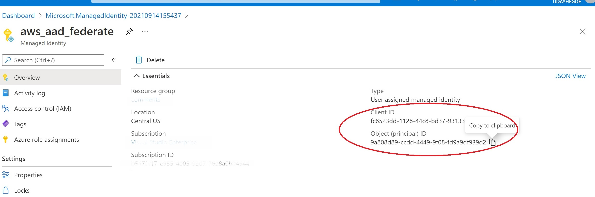
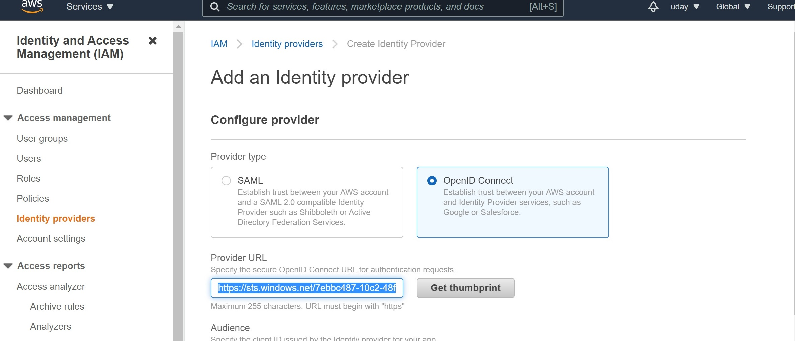
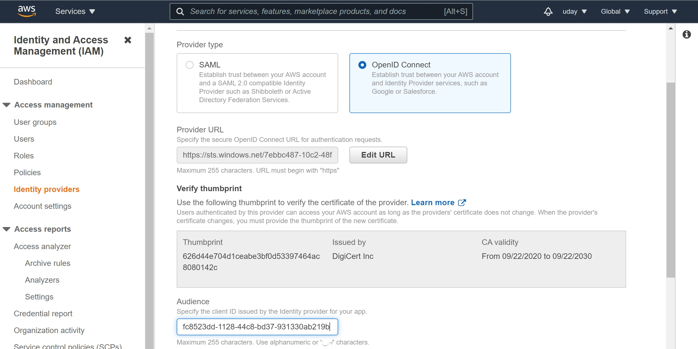
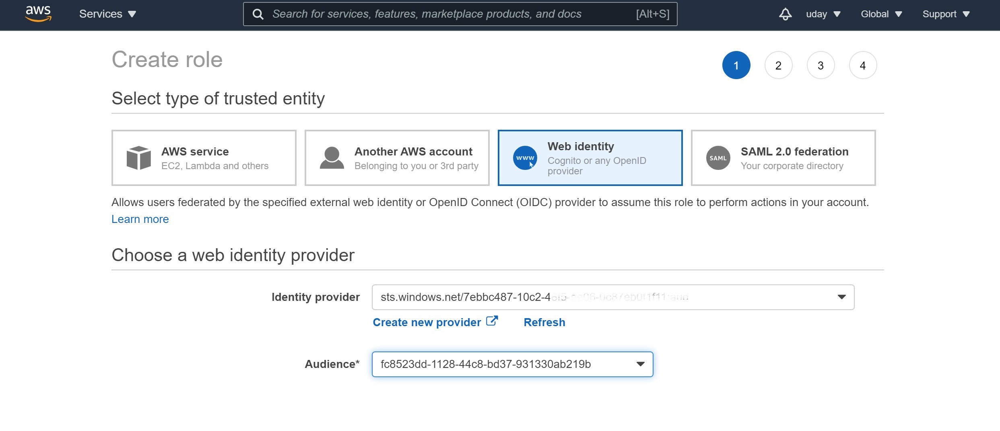
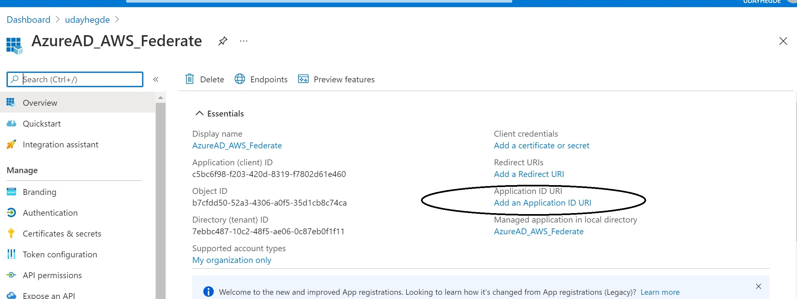
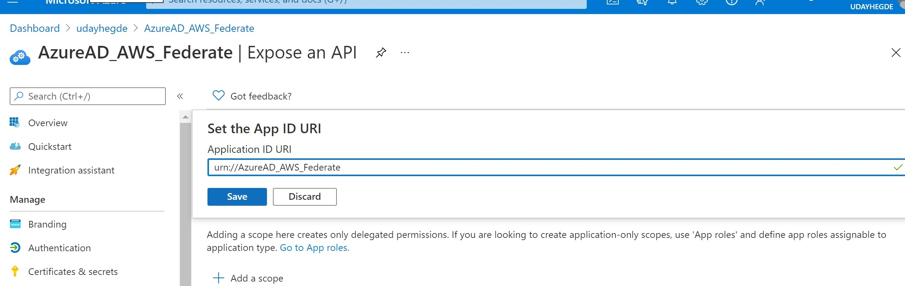
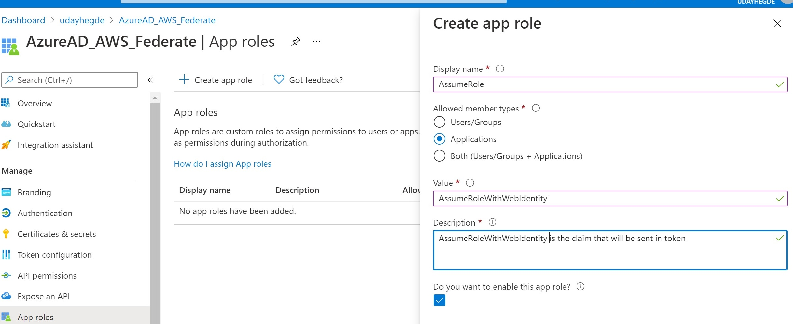
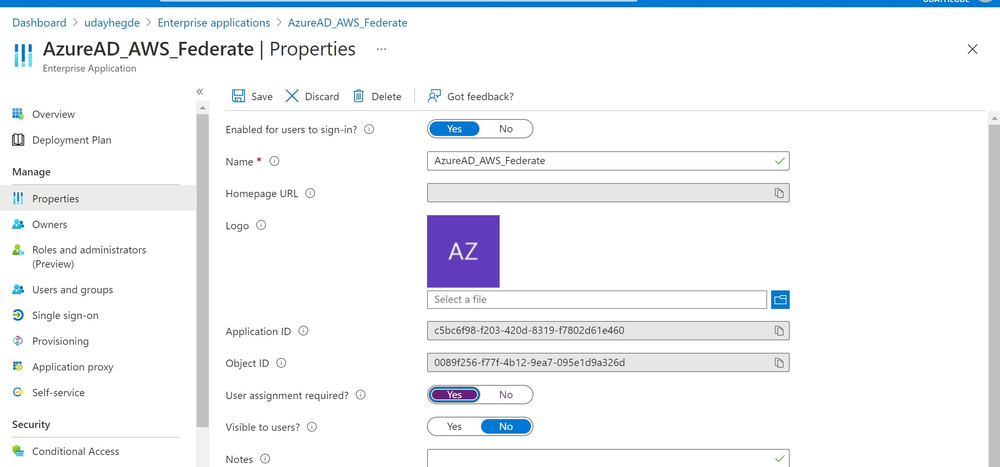

When developers build services that programmatically access Amazon Web Services (AWS) resources, they need to provision AWS credentials to these services. Storing these credentials securely and rotating them regularly is a challenge. Using a managed identity in Azure avoids the need to manage credentials either in AWS or Azure. This blog post provides a walkthrough of how you can configure managed identities in your Azure tenant with access to AWS resources.

## Introduction
While AWS documentation explains how users from specific identity providers can access AWS resources, it lacks concrete examples for service principals in Azure AD. AWS has support and documentation for federating users from any identity provider, and granting them access to AWS resources using [AssumeRoleWithWebIdentity](https://docs.aws.amazon.com/STS/latest/APIReference/API_AssumeRoleWithWebIdentity.html). We will use this concept and use the Azure AD tokens issued to a managed identity to access AWS resources.

### First, the concepts we will use to set this up

Before we jump into the specifics, let's refresh ourselves on a few concepts, to ensure that we can set this up securely and avoid any surprises later on.

#### Azure AD Managed Identity
The Azure AD managed identity is an Azure resource. It provides you with an identity where the credentials are managed by the Azure platform. When you run code in any of the Azure compute resources, such as App Services and Functions, you can use the managed identity to access resources you have granted that identity. Using these identities, you avoid having to store, secure, rotate or manage the credentials on your own.

#### Azure AD Tokens
Azure AD supports the open standard OAuth protocol to issue access tokens, as well as refresh tokens in many cases. When using managed identities to get tokens, we will be using the OAuth Confidential Client flow which only has access tokens. The expectation in this OAuth flow is that the client can detect when the token is expiring and get new access tokens as needed.

The OAuth token has a few components we need to familiarize with:
#### Subject claim
This is the "sub" claim in the OAuth access token and represents the identity to whom this token was issued. 

#### Audience claim
This is the "aud" claim in the OAuth token and represents the identity of the intended recipient of the token. When accepting tokens, it is important to only accept tokens intended for you to avoid security issues. 

#### Expiry claim
This is the "exp" claim in the OAuth token and represents how long the token is valid. The recipient of the token should check this claim to ensure the token being presented is not an old/stale token. This is also the information your client can use to determine when you need to "refresh" your access tokens.

#### Role claims
OAuth also allows the token to contain other custom claims. Azure AD access tokens include a "roles" claim which will include all the app roles assigned to the "subject" to whom the token was issued. See [recieve app roles in tokens](https://docs.microsoft.com/en-us/azure/active-directory/develop/howto-add-app-roles-in-azure-ad-apps).

#### AWS AssumeRoleWithWebIdentity
AWS allows you to configure tokens issued by any identity provider to assume a role in AWS, and access AWS resources granted to that role.

#### Trust Relationship
This is the AWS policy document where you can configure the specific authorization rules so that only the identities you pick from that identity provider are allowed to assume the role. This is where we get to combine our knowledge of Azure AD OAuth token with the AWS trust policy behavior to set things up securely.

There are specific keys you can use in a trust relationship. See [the available keys for AWS web identity federation](https://docs.aws.amazon.com/IAM/latest/UserGuide/reference_policies_iam-condition-keys.html#condition-keys-wif) for more details.

### Putting this all together
So now we have refreshed ourselves on how Azure AD tokens behave and the possibility of using the token claims in the AWS trust relationship, let's look at how we make this secure. Our goal is to ensure that the AWS resources can only be accessed by the identities we have chosen.

First, we need to determine whether we want to achieve this with a single managed identity or we need multiple managed identities to assume the AWS role. 

Next, we need an audience in your Azure AD tenant that represents your AWS account, even though AWS is not really in your tenant. This will ensure that you don't use tokens with other audiences which have the potential for security issues. In Azure AD, we can choose to use the client_id of an Azure AD service principal as the audience or the Application URI of an Azure AD application as the audience. 

If we want to achieve this with a single managed identity, we can take a very simple approach and create that single managed identity dedicated to your AWS scenarios. We can then use the client_id of that managed identity as the audience when requesting tokens, with the managed identity getting a token for itself. We can then use the audience and subject claims in the token to limit that single managed identity to assume your AWS role.

However, if you need more than one identity in your tenant to assume the same AWS role, you can achieve this using an Azure AD Application dedicated for this purpose. You can then create an app role and assign multiple identities to this role. Ideally, you would be able to use the audience claim along with the role claim when authorizing these identities to assume the AWS role. However the AWS conditions only seem to support aud and sub, so you need to work around this restriction by using capabilities in the Azure AD application model, which we will look at later in this blog.

## Option 1: Using one managed identity
First, let's take the simple approach and set this up using a single identity. 

Go to the Azure portal and create a "User assigned managed identity", and copy its client id and object id, you will need these later.



### Setting up AWS federation with your Azure AD Tenant
#### Create an identity provider in AWS
Head over to the AWS console, and select the IAM service. Click on "Identity providers", and "Add provider". Choose the "OpenID Connect" option.
In the provider URL, enter https://sts.windows.net/[your-tenant-id]. If you don't have your tenant id handy, see [how to find your tenant id](https://docs.microsoft.com/en-us/azure/active-directory/fundamentals/active-directory-how-to-find-tenant).


Click on "Get Thumbprint". I am not sure why AWS is acquiring this statically. I was expecting AWS to follow the chain of trust dynamically as needed.



Use the client id of your managed identity as the audience and click on "Add Provider".



#### Assign a role to that identity provider
Next, you need to create an AWS role and assign it to this provider. This will allow you to use the Azure AD tokens to assume this AWS role. Click on the identity provider you just created, and click on "Assign role", and "Create a new role".

In "Select type of trusted identity", you should see AWS has already picked "Web identity" and populated your identity provider. Select the audience you just configured on the provider. (Note: You can configure this identity provider with additional audiences if you need to.)



Click on permissions and configure the finer-grained permissions you want to grant to this role. You can pick among existing policies or create a custom policy. In the review step, you get to provide a name for this role and a description, and click "Create Role".

Now, pick the role you just created, click "trust relations", and "Edit trust relationship".

```json
{
  "Version": "2012-10-17",
  "Statement": [
    {
      "Effect": "Allow",
      "Principal": {
        "Federated": "arn:aws:iam::<your-aws-account-id>:oidc-provider/sts.windows.net/<your-tenant-id>"
      },
      "Action": "sts:AssumeRoleWithWebIdentity",
      "Condition": {
        "StringEquals": {
          "sts.windows.net/<your-tenant-id>:aud": "<client id of managed identity>"
        }
      }
    }
  ]
}
```
Anyone who can get a token for this audience in your tenant will be able to access the AWS resources granted to this role. So you should restrict this further to the specific identity you are allowing, by using the subject condition.


```json
{
  "Version": "2012-10-17",
  "Statement": [
    {
      "Effect": "Allow",
      "Principal": {
        "Federated": "arn:aws:iam::<your-aws-account-id>:oidc-provider/sts.windows.net/<your-tenant-id>"
      },
      "Action": "sts:AssumeRoleWithWebIdentity",
      "Condition": {
        "StringEquals": {
          "sts.windows.net/<your-tenant-id>:aud": "<client id of managed identity>",
          "sts.windows.net/<your-tenant-id>:sub": "<object id of managed identity>"
        }
      }
    }
  ]
}
```
### Finally, access the AWS resources from your service!
You have now completed all the configurations needed to try this out end to end.
Let's look at a code sample to get Azure AD tokens and provide that to AWS.

Assign the managed identity to your Azure App Service (or Functions) where your code is running. Then use the Azure Identity SDK to get a token for that managed identity with the audience being the client id of your managed identity. Here's a code snippet using Node.js

```javascript
    const identity = require("@azure/identity");
    const clientId = "<client id of managed identity>"
    const audience=clientId;

    const credential = new identity.DefaultAzureCredential(
                    { ManagedIdentityClientId : clientId });
    const token = credential.getToken(audience);
```


As discussed earlier in this blog, this is the OAuth Confidential Client flow: you get access tokens, but no refresh tokens. You need to make sure this token is refreshed regularly before it expires. The instructions for how to do this vary depending on the AWS SDK you use.
For example, when using the aws-sdk for Node.js, here's a snippet I used

```javascript
public tokenRefresh = async() =>{
    return credential.getToken(audience)
    .then ((response:any) => {
        if (response) {
            //update the token in the AWS credentials class
            AWS.config.credentials.params.WebIdentityToken = response.token
            //set a timer to refresh the token when it expires. We may need the timer to trigger
            //a bit earlier, and not wait till the token is expired
            setTimeout(tokenRefresh, 
                       response.expiresOnTimestamp - Date.Now());
        }
        else {...}
    }
    .catch(...){...}
}
```


## Option 2: using an Azure AD Application.
You can also use an Azure AD application and use the Azure AD App model capabilities for some additional flexibility: especially in being able to allow multiple managed identities to assume the AWS role.

The ideal way to achieve this would have been to assign the managed identities to an app role, and then use the role claim in AWS to authorize assuming the AWS role. However, AWS does not support the use of custom claims in the token. So we have to find other creative ways to solve this problem. We will use the following on the Azure AD side to enforce who can get the token with the application audience:
- Configuring your Azure AD application to require user assignment. This will ensure that only identities assigned to the application can get a token with the application audience
- Create an application role and assign your selected managed identities to that role.
- make sure no one adds any other roles or assign other identities to the application

Here's the configuration information if you choose to go this route.
Go to your Azure AD portal, and visit Application Registrations, and create an application. Configure the Application ID URI.



The URI can be any name you choose, and it will be the audience when you acquire a token for the app. For example: api://AWS_Application or URN://AzureAD_AWS_Federate


Next, create an application role, and specify that only applications are the allowed member types. This part can be a bit confusing, since "applications" here is a misnomer. It should say "Service Principals", which also includes managed identities.



Configure the application to require user assignment. Again this part can be confusing, since "user assignment" is a misnomer. You can assign any Azure AD identities, including service principals. This step will ensure that only those identities assigned to the application can get a token for the application audience.



Finally, we need to assign our managed identity to this role. Unfortunately, Azure AD does not provide this role assignment in the portal. You have to use PowerShell and bear with me since this PowerShell cmdlet is quite a handful with duplicate parameters which should have been unnecessary. This document [shows how to assign a managed identity to an app role](https://docs.microsoft.com/en-us/azure/active-directory/managed-identities-azure-resources/how-to-assign-app-role-managed-identity-powershell)

For this step, you need 3 things: the object id of the managed identity, the identity of the app role you created, and the object id of the service principal that represents the application you created. You can find this last part by going to the Enterprise Applications on the Azure AD portal, and search for the application name you just created. The object you find is the service principal of the application, and you can look up the object id of that service principal.

You will be executing a PowerShell cmdlet that looks like this:
```
New-AzureADServiceAppRoleAssignment \
     -ObjectId <object id of your managed identity> \
     -Id <identity of the app role> \
     -PrincipalId <object id of managed identity again!> \
     -ResourceId <object id of the application service principal in your tenant>
```

Now configure the AWS role appropriately as follows:
Set your app URI audience on your identity provider in AWS. On the AWS portal, go to the IAM service, and pick identity providers. Select the identity provider you added and pick "add audience" under Audiences. Add the app URI of your app as the audience.

Then pick roles on the IAM service portal, and select the role we configured called AzureADWebIdentity. In the "Trust Relationships", edit trust relationship, and change the audience to the app uri of your application. Since you are already managing who can get the app tokens using the app role assignments on the application, the subject claim is optional and not needed. And especially if you have multiple managed identities assigned to the role, you will not be able to use the "sub" key since it will only allow you to specify one identity.
```json
{
  "Version": "2012-10-17",
  "Statement": [
    {
      "Effect": "Allow",
      "Principal": {
        "Federated": "arn:aws:iam::<your-aws-account-id>:oidc-provider/sts.windows.net/<your-tenant-id>"
      },
      "Action": "sts:AssumeRoleWithWebIdentity",
      "Condition": {
        "StringEquals": {
          "sts.windows.net/<your-tenant-id>:aud": "urn://AzureAD_AWS_Federate",
        }
      }
    }
  ]
}
```

Change your code to specify your app uri as the audience when acquiring an Azure AD token.
```javascript
    const identity = require("@azure/identity");
    const audience="urn://AzureAD_AWS_Federate";

    const credential = new identity.DefaultAzureCredential(
                    { ManagedIdentityClientId : this.clientId });
    const token = credential.getToken(audience);
```


Hope this blog post makes it easier for you to configure access to AWS resources using Azure AD workload identities!

Comments/feedback/questions? [DM me on twitter](https://twitter.com/messages/compose?recipient_id=1446741344)
