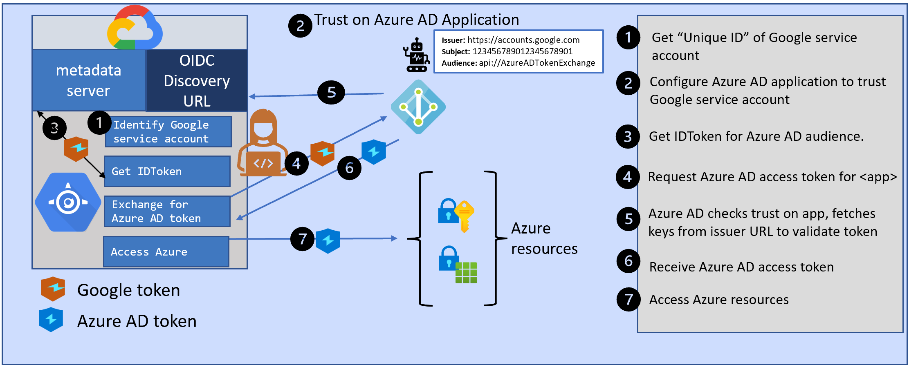
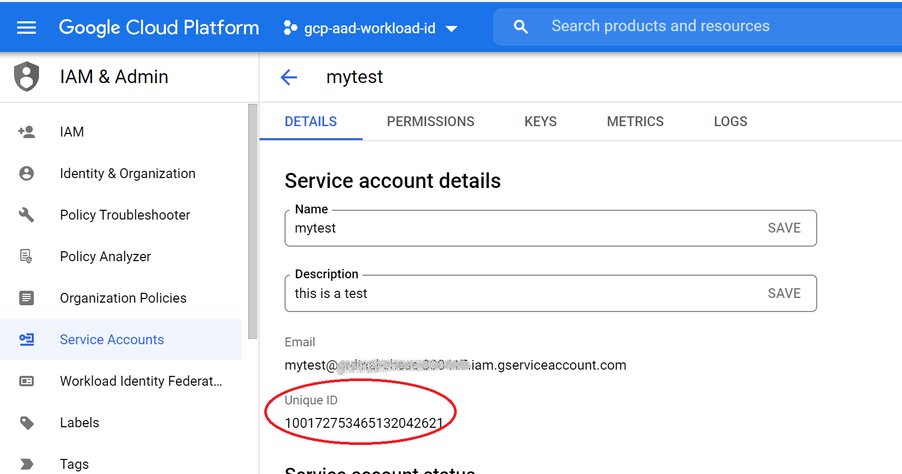

When applications or services run in environments outside Azure, they need Azure AD application secrets to authenticate to Azure AD and access resources such as Azure and Microsoft Graph. These secrets pose a security risk if they are not stored securely and rotated regularly. Azure AD workload identity federation removes the need for these secrets in selected scenarios. Developers can configure their Azure AD applications to trust tokens issued by another identity provider. This blog post explores how you can access Azure resources without needing secrets when your services are running in the Google Cloud Platform.




## Using Azure AD workload identity federation with Google Cloud
An [earlier blog post]() discussed several aspects of Azure AD workload identity federation. In the GitHub Actions scenario, the AzureLogin action handled all the logic of getting a GitHub token and exchanging it for an Azure AD token. When your service is running in a cloud platform such as Google Cloud, you need to code a similar logic in your service.

First, let's look at how developers access Azure resources from their services running in Google Cloud today. They first create an application registration in Azure AD and give it the necessary permissions in Azure. Then they configure the application with a secret and use that secret in their service in Google to request an access token for that application from Azure AD.

With Azure AD workload identity federation, you can avoid creating these secrets in Azure AD when your services are running in Google Cloud. Instead, you can configure your Azure AD application to trust a token issued by Google. 

There are three parts to using Azure AD workload identity federation from your service in Google.
1. An identity in Google Cloud to which Google will issue a token.
2. Configure Azure AD application to trust that Google token
3. Get a Google token for your service and exchange it for an Azure AD token

Let's look at each of these three parts in detail.

### Part 1: Use a service account in Google Cloud
We need an identity in the Google Cloud that can be associated with your Azure AD application. Google's concept of [service accounts](https://cloud.google.com/iam/docs/service-accounts) will serve this purpose. You can either use the default service account of your Google project or create a dedicated service account for this purpose.

Each service account has a "Unique ID". When you visit the "IAM & Admin" page in the Google Cloud console, click on Service Accounts. Select the service account you plan to use, and copy its Unique ID. 


Tokens issued by Google to the service account will have this unique id as the subject claim. The issuer claim in the tokens will be "https://accounts.google.com". 

We will use these details to configure a trust on Azure AD applications, to allow your application to trust tokens issued by Google to your service account.

### Part 2: Configuring Azure AD application to trust a Google token
Azure AD applications support the capability to add "federatedIdentityCredentials" to set up this trust. You can add up to twenty of these trusts to each Azure AD application.

The most important parts of the federated identity credential are the following:
- subject: this should match the "sub" claim in the token issued by another identity provider, such as Google. This is the Unique ID of the service account you plan to use.
- issuer: this should match the "iss" claim in the token issued by the identity provider. This needs to be an URL that must comply with the OIDC Discovery Spec. Azure AD will use this issuer URL to fetch the keys that are necessary to validate the token. In the case of Google cloud, the issuer is  "https://accounts.google.com"
- audience: this should match the "aud" claim in the token. For security reasons, you should pick a value that is unique for tokens meant for Azure AD. The Microsoft recommended value is "api://AzureADTokenExchange".

The Microsoft Graph beta endpoint (https://graph.microsoft.com/beta) exposes REST APIs to create, update, delete federatedIdentityCredentials on applications. 

Here are a few options for configuring a federated identity credential on an Azure AD application.
#### Using Azure CLI
The Azure CLI does not natively support federated identity credentials yet. If the Azure CLI is your preferred tool, you can use its rest interface to call the Microsoft Graph APIs directly. I recommend you do this in the Azure Cloud Shell. Your mileage will vary if you run it in any other command-line tools. $appObj in the example below is the object id of your Azure AD application.
```
az rest --method POST --uri 'https://graph.microsoft.com/beta/applications/'$appObj'/federatedIdentityCredentials'  --body '{"name":"<aUniqueNameWithinYourApp>","issuer":"<your issuer>","subject":"<your subject>","audiences":["api://AzureADTokenExchange"]}'
```

#### Using the Microsoft Graph SDKs.
You can also use the Microsoft Graph SDKs, available in several languages, to view or modify a federated identity credential. You can choose either the delegated flow or the application-only flow: just make sure the service principal you use for this purpose has been consented with the Application.ReadWrite.All permissions.

The federatedIdentityCredentials are currently in beta (https://graph.microsoft.com/beta/applications/"object-id-of-app"/federatedIdentityCredentials). The following SDKs have support for the beta endpoint. 

- .Net [https://github.com/microsoftgraph/msgraph-beta-sdk-dotnet](https://github.com/microsoftgraph/msgraph-beta-sdk-dotnet)
- Javascript, [https://github.com/microsoftgraph/msgraph-sdk-javascript](https://github.com/microsoftgraph/msgraph-sdk-javascript)
- Java, [https://github.com/microsoftgraph/msgraph-beta-sdk-java](https://github.com/microsoftgraph/msgraph-beta-sdk-java)
- PHP [https://github.com/microsoftgraph/msgraph-beta-sdk-php](https://github.com/microsoftgraph/msgraph-beta-sdk-php)
- Go [https://github.com/microsoftgraph/msgraph-beta-sdk-go](https://github.com/microsoftgraph/msgraph-beta-sdk-go)


(Note that Javascript does not have a separate beta SDK. You can specify the api-version when you initialize the graph client, as follows)
```javascript
import {Client} from "@microsoft/microsoft-graph-client";

// pick one of the several auth provider options

const graphClient = Client.initWithMiddleware({ 
        defaultVersion: 'beta',
        authProvider
});

// idName, issuer, subject are variables set with the necessary values
const newCredential = {
    name : idName,
    issuer : issuer,
    subject: subject,
    audience : "api://AzureADTokenExchange"
};

return graphClient.api(`/applications/${appId}/federatedIdentityCredentials/`).post(newCredential); 
```


### Part 3: Getting a Google token and exchanging it for an Azure AD token
Now that we have configured the Azure AD application to trust the Google service account, we are ready to get a token from Google and exchange it for an Azure AD access token,

#### Getting an ID token for your Google service account
As mentioned earlier, Google cloud resources such as app-engine automatically use the default service account of your Google project. You can also configure the app-engine to use a different service account when you deploy your service. Your service can request an [ID token](https://cloud.google.com/compute/docs/instances/verifying-instance-identity#request_signature) for that service account from the "metadata service endpoint" that handles such requests. With this approach, you dont need any keys for your service account: these are all managed by Google. Here's an example in Node.js:
```javascript
async function googleIDToken() {
    const headers = new Headers();
    const endpoint="http://metadata.google.internal/computeMetadata/v1/instance/service-accounts/default/identity?audience=api://AzureADTokenExchange";
    return fetch(endpoint, {method: "GET", headers: headers});
}
```
You are requesting Google for a token to identify your service account (an ID token) to Azure AD. Note that the audience here needs to match the audience value you configured on your Azure AD application when setting up the federated identity credential.


#### exchanging the identity token for an Azure AD access token
Now that you have an identity token from Google, we can exchange this for an Azure AD access token. The Microsoft Authentication Library (MSAL) has been updated to allow you to pass the Google token as a "clientAssertion".  Using this support in MSAL, you can write your  token class that implements the "TokenCredential" interface, which can then be used in the different Azure SDKs. The following MSAL versions have support for clientAssertions:
- [MSAL Go (Preview)](https://github.com/AzureAD/microsoft-authentication-library-for-go)
- [MSAL Node](https://github.com/AzureAD/microsoft-authentication-library-for-js/tree/dev/lib/msal-node)
- [MSAL .Net](https://github.com/AzureAD/microsoft-authentication-library-for-dotnet)
- [MSAL Python](https://github.com/AzureAD/microsoft-authentication-library-for-python)

Here's a sample code snippet to demonstrate this, extracted from [my GitHub repo](https://github.com/udayxhegde/aad-federate-keyvault-node)
```javascript
const msal = require("@azure/msal-node");
import {TokenCredential, GetTokenOptions, AccessToken} from "@azure/core-auth"

class ClientAssertionCredential implements TokenCredential {

    constructor(...) {
        //constructor stuff. Store clientID, aadAuthority, tenantID for later use
    }
    
    async getToken(scope: string | string[], _options?: GetTokenOptions):Promise<AccessToken> {

        var scopes:string[] = [];           
        // write code here to update the scopes array, based on scope paramenter


        return googleIDToken() // calling this directly just for clarity, 
                               // this should be a callback
        .then((clientAssertion:any)=> {
            let msalApp = new msal.ConfidentialClientApplication({
                auth: {
                    clientId: this.clientID,
                    authority: this.aadAuthority + this.tenantID,
                    clientAssertion: clientAssertion,
                }
            });
            return msalApp.acquireTokenByClientCredential({ scopes })
        })
        .then(function(aadToken) {
            // return  in form expected by TokenCredential.getToken
            return({ 
                token: aadToken.accessToken,
                expiresOnTimestamp: aadToken.expiresOn.getTime()
            });
        })
        .catch(function(error) {
            // error stuff
        });
    }
}
```
Here's an example of how you can use this in an Azure SDK such as storage-blob
```javascript
const { BlobServiceClient } = require("@azure/storage-blob");

const tokencredential =  new ClientAssertionCredential(...);
                                             
const blobClient = new BlobServiceClient(blobUrl, tokenCredential);

```
When you make requests to the blobClient to access storage, the blobClient calls the getToken method on the ClientAssertionCredential. This results in a request for a fresh ID token from the metatdata server which then gets exchanged for an Azure AD access token.

### In conclusion
Azure AD workload identity federation is a new capability that allows you to get rid of secrets in several scenarios such as GitHub Actions workflow and services running in Google Cloud. Stay tuned for many more scenarios where this capability can be used to get rid of secrets.

If you have any comments, feedback, or suggestions on this topic, I would love to hear from you. [DM me on twitter](https://twitter.com/messages/compose?recipient_id=1446741344)

