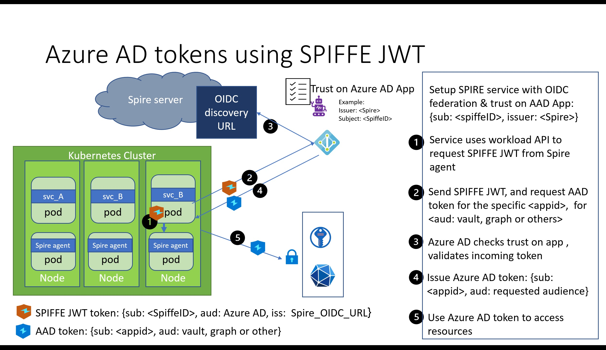
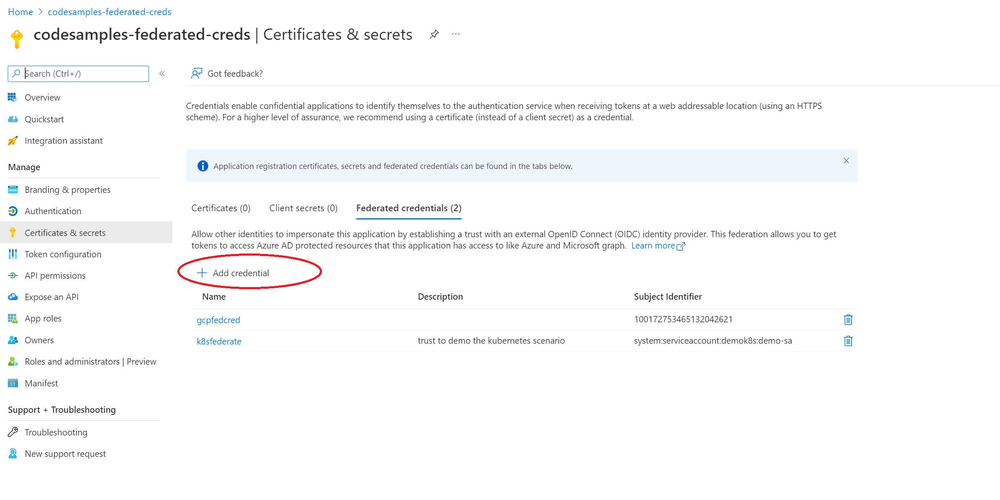
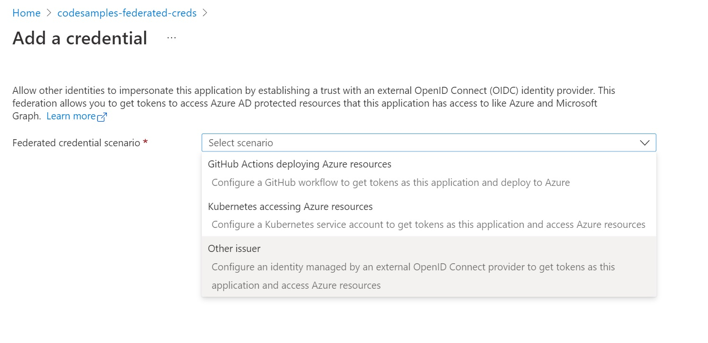
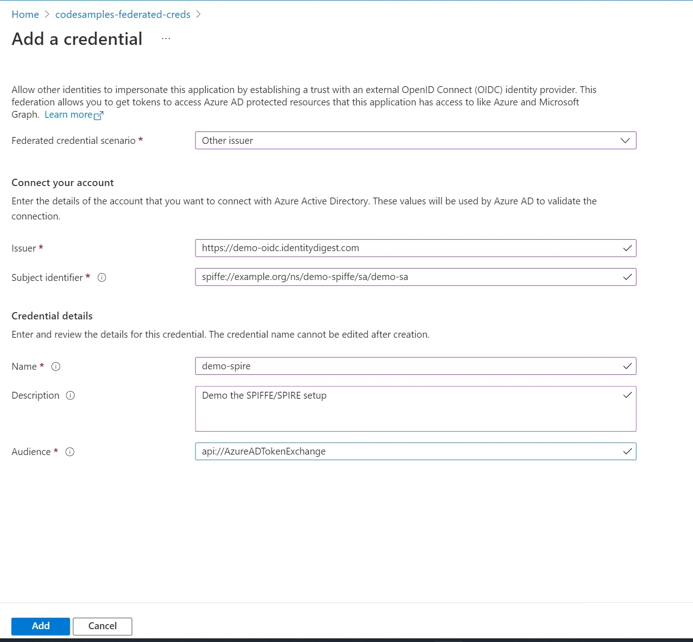

[SPIFFE](https://spiffe.io/docs/latest/spiffe-about/overview/) is a set of open-source standards for providing identities to your software workloads. Since it is platform agnostic with possibilities such as mTLS, it is an attractive option for services deployed across platforms and cloud vendors. 
The [Kubernetes blog post]() discussed how services running in a Kubernetes cluster can use Azure AD workload identity federation to access Azure resources without needing secrets. This blog post explores how services relying on SPIFFE can also use this capability to access Azure resources. No secrets are necessary.



# What are SPIFFE and SPIRE?
SPIFFE is a set of open-source standards and specifications. They specify how software workloads can dynamically get an identity (SPIFFE ID) in heterogeneous environments. These workloads are issued cryptographic identity documents called SVIDs in two formats: X.509 certificate and JWT token. There are several reasons why SPIFFE is an attractive option for developers:
- The short-lived X.509 certs enable mutual authentication and data encryption (mTLS)
- Allows a uniform model for building services deployed in heterogeneous platforms and environments, with support for Kubernetes, Azure, AWS, GCP, bare-metal, etc.
- Workload attestation allows dynamic assignment of identities as services come and go
- User-friendly names for SPIFF ID (eg: spiffe://demo.identitydigest.com/demo/client)
- Can integrate with service mesh offerings such as Istio.
- Open-source.

SPIRE is the reference implementation of the SPIFFE specifications. 

The [SPIFFE concepts](https://spiffe.io/docs/latest/spiffe-about/spiffe-concepts/) and [SPIRE concepts](https://spiffe.io/docs/latest/spire-about/spire-concepts/) are great resources to learn more about SPIFFE and SPIRE. The [quickstart for Kubernetes](https://spiffe.io/docs/latest/try/getting-started-k8s/) and [OIDC authentication with AWS](https://spiffe.io/docs/latest/keyless/oidc-federation-aws/) are good references to use for deploying SPIFFE and SPIRE. 

# Using Azure AD workload identity federation with SPIFFE and SPIRE
My [GitHub repo](https://github.com/udayxhegde/aad-federate-blobstore-node) uses a modified version of these quickstart materials. It has two key aspects that are different from the SPIRE quickstarts:
- We will use an updated version of the OIDC discovery provider.  It supports adding the "use" key required by Azure AD in the OIDC discovery document. Rather than co-host this provider with the SPIRE server, we will run it as a separate service.
- We will use a client workload that gets a SPIFFE JWT token and accesses Azure Blob Store.

Our walk-through will comprise of four parts:
1. Setup SPIRE components in a Kubernetes cluster. Configure it with JWT and OIDC discovery support.
2. Deploy a sample workload in our cluster and assign it a SPIFFE ID 
3. Configure an Azure AD application to trust the SPIFFE ID.
4. Use the SPIFFE JWT issued to our service to access Azure resources

## Part 1: Setting up the SPIRE components with JWT and OIDC support
We will use example.org as our trust domain, as used in the SPIRE quickstarts. The [yaml files in my repo](https://github.com/udayxhegde/aad-federate-blobstore-node/tree/main/deployment/spiffe) are in two folders:
1. [spire server and agents](https://github.com/udayxhegde/aad-federate-blobstore-node/tree/main/deployment/spiffe/spire)
2. [OIDC discovery](https://github.com/udayxhegde/aad-federate-blobstore-node/tree/main/deployment/spiffe/oidc)

For this part, you need the following:
- a Kubernetes cluster where you deploy the SPIRE components (server, agent, OIDC discovery).
- a domain name to host the OIDC discovery endpoint. You will need permissions to manage the DNS records of that domain name.

You also need to customize these files from my repository to suit your environment. The following changes are needed:
1. Look for the TODO comments in server-configmap-oidc.yaml. Replace the FQDN of the discovery domain with your domain name. Replace the cluster name with the name of your cluster.
2. Look for the TODO comments in the agent-configmap.yaml. Replace the cluster name with the name of your cluster
3. Look for the TODO comments in the oidc-ingress.yaml. Replace the FQDN of the OIDC discovery domain with your domain name
4. Look for the TODO comments in the oidc-dp-configmap.yaml. Replace the FQDN of the OIDC discovery domain with your domain name. Also, change the email reference.

#### After you make these changes, deploy the SPIRE server:
Go to the deployment/spiffe/spire directory and deploy the server:
```
kubectl apply -f spire-namespace.yaml
kubectl apply -f server-account.yaml \
              -f spire-bundle-configmap.yaml \
              -f server-cluster-role.yaml
kubectl apply -f server-configmap-oidc.yaml \
              -f server-statefulset.yaml \
              -f server-service.yaml
```
Next, deploy the agents:
```
kubectl apply -f agent-account.yaml \
              -f agent-cluster-role.yaml
kubectl apply -f agent-configmap.yaml \
              -f agent-daemonset.yaml
```

Confirm that the server and agents are up and running.
```
kubectl get pods -n spire

NAME                                   READY   STATUS    RESTARTS   AGE
spire-agent-2w9dp                      1/1     Running   0          1d
spire-agent-bgpzq                      1/1     Running   0          1d
spire-agent-ctjgj                      1/1     Running   0          1d
spire-server-0                         1/1     Running   0          1d
```

Assign a SPIFFE identity to each of the agents running on the nodes. Agents will be able to authenticate to the SPIFFE server using this identity. Following this, we can also assign identities to our other workloads running in the cluster.

```
kubectl exec -n spire spire-server-0 -- \
  /opt/spire/bin/spire-server entry create \
  -spiffeID spiffe://example.org/ns/spire/sa/spire-agent \
  -selector k8s_sat:cluster:<YOUR_CLUSTER_NAME> \
  -selector k8s_sat:agent_ns:spire \
  -selector k8s_sat:agent_sa:spire-agent \
  -node
```

#### Now deploy the OIDC server
The SPIRE implementation of the OIDC discovery provider is at https://gcr.io/spiffe-io/oidc-discovery-provider. 

Azure AD requires that the JWKS pointed by the OIDC discovery URL contains a "use" key with the value "sig". By default, the SPIRE OIDC discovery provider does not add this key. Adding this key is [an option added recently](https://github.com/spiffe/spire/issues/2623) to add this key. It's available in v1.1.2 or above as well as the recent nightly builds of the OIDC discovery provider at gcr.io/spiffe-io/oidc-discovery-provider:nightly. 

Go to the deployment/spiffe/oidc directory, and deploy the OIDC discovery service.
```
kubectl apply -f oidc-account.yaml \
              -f oidc-dp-configmap.yaml
kubectl apply -f oidc-ingress.yaml \
              -f oidc-service.yaml
kubectl apply -f oidc-deployment.yaml

kubectl get pods -n spire
NAME                                   READY   STATUS    RESTARTS   AGE
spire-agent-2w9dp                      1/1     Running   0          1d
spire-agent-bgpzq                      1/1     Running   0          1d
spire-agent-ctjgj                      1/1     Running   0          1d
spire-oidc-provider-8666c9c5fb-zzr6k   1/1     Running   0          1d
spire-server-0                         1/1     Running   0          1d
```
This OIDC provider will set up the OIDC discovery endpoint for us. It will publish the keys needed by other providers to validate the tokens issued by the SPIRE server. We will assign it a SPIFFE identity to authenticate to the server.
```
kubectl exec -n spire spire-server-0 -- \
  /opt/spire/bin/spire-server entry create \
  -spiffeID spiffe://example.org/oidc-discovery \
  -parentID spiffe://example.org/ns/spire/sa/spire-agent \
  -selector k8s:ns:spire \
  -selector k8s:sa:spire-oidc
```

The OIDC discovery endpoint needs to be reachable over the internet. This will allow other identity providers to validate the JWT issued to workloads. For this reason, the OIDC provider service will publish an external IP address. 
```
kubectl get service -n spire

NAME           TYPE           CLUSTER-IP     EXTERNAL-IP   PORT(S)          AGE
spire-oidc     LoadBalancer   10.0.170.196   21.98.214.16   443:31873/TCP    13d
spire-server   NodePort       10.0.89.46     <none>        8081:30494/TCP   13d
```
Your OIDC discovery domain should point to this external IP of the OIDC endpoint. Visit the DNS administration page for your OIDC discovery domain. Add an A record for your host with the external IP address as the value. For example, I am using demo-oidc.identitydigest.com. So my A record says host=oidc, value=IP address of my OIDC service.

At this point, you should see your OIDC discovery endpoint and the related JWKS:
https://YOUR_OIDC_DISCOVERY_DOMAIN/.well-known/openid-configuration

This is roughly what you would expect to see. It's an example from my demo setup:

```
{
  "issuer": "https://demo-oidc.identitydigest.com",
  "jwks_uri": "https://demo-oidc.identitydigest.com/keys",
  "authorization_endpoint": "",
  "response_types_supported": [
    "id_token"
  ],
  "subject_types_supported": [],
  "id_token_signing_alg_values_supported": [
    "RS256",
    "ES256",
    "ES384"
  ]
}
```
https://YOUR_OIDC_DISCOVERY_DOMAIN/keys. This is an example from my demo setup: 
```
{
  "keys": [
    {
      "use": "sig",
      "kty": "RSA",
      "kid": "mM0QXrh1f17ChHyWHQO0OF4zHT5isaYb",
      "n": "zmK4Kfn00s-ZDZbUICSaTewB9ZmTmVrf_uRk6wsL3PdNqNXhznrssH7qmaIprw-it3ReZPYkVyuPrrFY1soWu39a1U7dY48BwuqbIP8DsIUMTa_0FjJtgQ2M4JuYicSpFBY20By85hdQF3Gyzge1WCXf_HwFaCmu0qJ_xshYMABeUM_wm8ioSk67Jfe3pMfDKkY-UETJ3UnssXyHAhKTbHO0aqEmm5Szu6pzs3KQwedOLJkfrTBFDwJNWncczJjPJoOm_enRAH4NVQ-LdDEf5vze0StXxegiSOvmmn0W01Iqr9ukr-kGh7ch4meQ8rihKQMLQEi3hzQC8XAPgOcH3Q",
      "e": "AQAB"
    }
  ]
}
```
Notice the "use" key needed by Azure AD. We are updating Azure AD so this is optional in the future. In the meanwhile, you need to tell the OIDC provider to add this.  I am achieving that with the following in my oidc-dp-configmap.yaml: 
```
set_key_use = true
```

### Part 2: Deploy a sample workload and assign it a SPIFFE ID
The source code in the GitHub repo has a sample workload. Create a container image and add it to your image repository. 

Here is an example, which refers to my Azure Container Repository:
```
npm run build
docker build -f deployment\docker\dockerfile -t storefederate .

docker tag storefederate acruday.azurecr.io/storefederate:v1
az acr login -n acruday.azurecr.io

Docker push acruday.azurecr.io/storefederate:v1
```

Now deploy this workload on the cluster. Go to the deployment/spiffe/client folder in the repo. **Make sure you modify the deployment.yaml file to point to your image**
```
kubectl apply -f demo-namespace.yaml
kubectl apply -f serviceaccount.yaml 
kubectl apply -f deployment.yaml
kubectl apply -f service.yaml
```

We will assign a SPIFFE ID to this workload based on its namespace and Kubernetes service account. 

```
kubectl exec -n spire spire-server-0 -- \
  /opt/spire/bin/spire-server entry create \
  -spiffeID spiffe://example.org/ns/demo-spiffe/sa/demo-sa \
  -parentID spiffe://example.org/ns/spire/sa/spire-agent \
  -selector k8s:ns:demo-spiffe \
  -selector k8s:sa:demo-sa
```

Our workload now has been assigned a SPIFFE ID: spiffe://example.org/ns/demo-spiffe/sa/demo-sa

### Part 3: Configure an Azure AD application to trust this SPIFFE ID.
We will add a federated identity credential to our Azure AD application. The two primary components needed to add this are: 
- the issuer URL. The is the OIDC discovery URL we configured earlier. In my demo environment, it is https://demo-oidc.identitydigest.com
- the subject identifier. The SPIFFE ID issued to our workload. (spiffe://example.org/ns/demo-spiffe/sa/demo-sa)

#### Using the Azure AD portal
**These changes are coming soon, before the end of this week (1/14/2022)**

The Azure AD portal has added preview features to simplify this configuration. Visit the Azure AD portal, and pick your application under "App registrations". Go to "Certificated & secrets" and pick "Federated Credentials". Select "Add credential". 


In the "Federated credential scenario", pick "Other issuer".


Provide your OIDC discovery domain as the issuer URL. The SPIFFE ID is the subject identifier. 


#### other ways to achieve this
You can also use the Azure CLI or do this programmatically. See [this blog post](#AzureADTrust) for details.

### Part 4: Get a SPIFFE JWT and access Azure resources
The earlier blog posts of [Kubernetes]() and [Google Cloud]() showed how you can use an external trusted token to access Azure resources. We will use the same model here. The primary difference is how you get the JWT for your SPIFFE identity.

SPIFFE defines a workload API to get the SVIDs. This API defines how workloads talk to the SPIFFE agent to get either the X.509 certs or the JWTs. [This](https://github.com/spiffe/go-spiffe/blob/main/proto/spiffe/workload/workload.proto) proto file defines the surface of this workload API.

Here's a sample function in Node.JS to get a SPIFFE JWT.

```javascript
async function SPIFFEToken() {
  return new Promise<any>((resolve, reject) => {
    var meta = new grpc.Metadata();
    meta.add('workload.spiffe.io', true);

    this.grpcClient.FetchJWTSVID({audience: ['api://AzureADTokenExchange']}, meta, function(err:any, message:any) {
      if (err) {
        logger.error("spiffe token error %o", err);
        reject(err);
      }
      else {
        logger.debug("spiffe token is %o", message);
        resolve(message.svids[0].svid);
      }   
    });
  });
}
```
You can then use this token in similar code as demonstrated in my earlier blogs for the Google and Kubernetes scenarios to access Azure resources. See [this blog post](#ExchangeMSAL) for details.

### In conclusion
Azure AD workload identity federation is a new capability that allows you to get rid of secrets in several scenarios such as SPIFFE, Kubernetes, services running in Google Cloud, and GitHub Actions workflow. Stay tuned for many more scenarios where you can use this capability to get rid of secrets.

If you have any comments, feedback, or suggestions on this topic, I would love to hear from you. [DM me on Twitter](https://twitter.com/messages/compose?recipient_id=1446741344)
