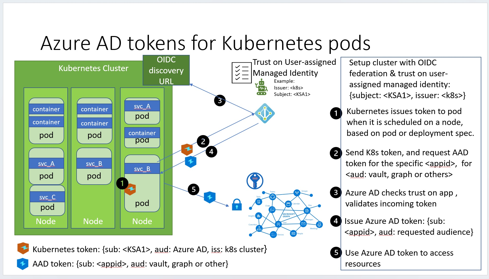
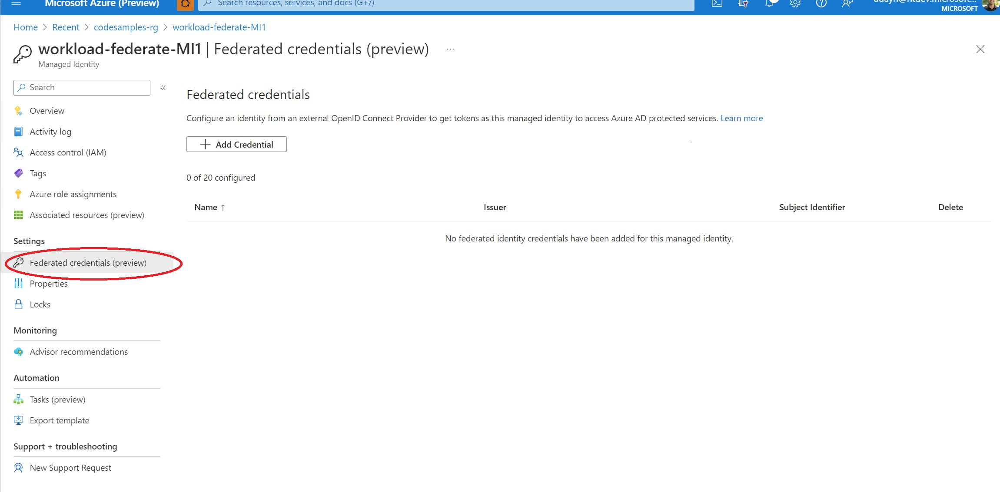
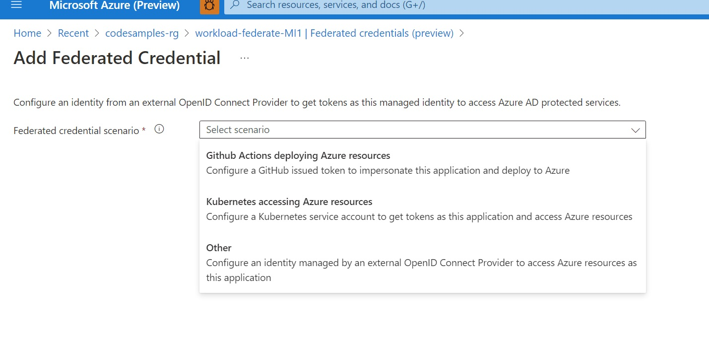
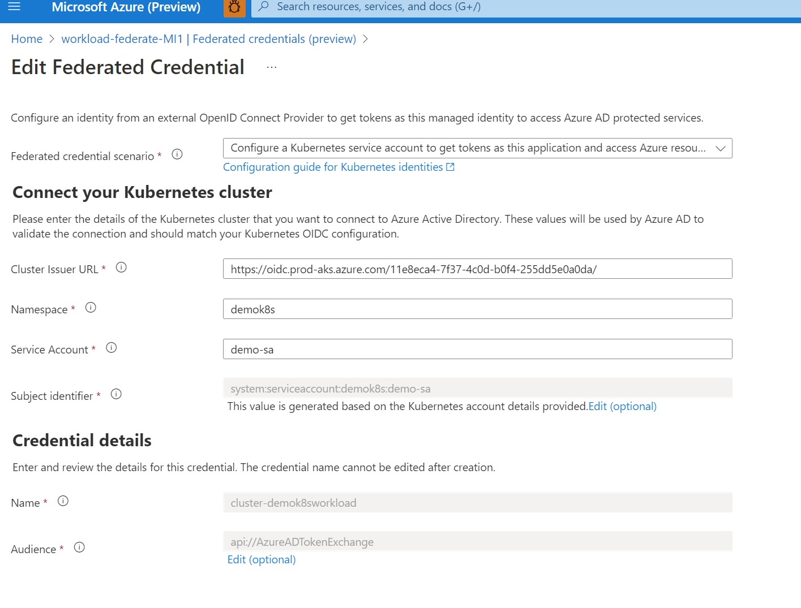

Yes! Workload Identity Federation is now available in public preview on User-assigned Managed Identities too! This change makes it easier for developers to access Azure resources from their software services running in Kubernetes clusters or running in the Google cloud or from GitHub Actions workflows. There have been several blogs posted on this site, such as [Kubernetes](),  [GitHub]() and [SPIFFE](), which walk through using an Azure AD application registration to configure workload identity federation. This blog walks you through using managed identities instead of application registrations to enable those scenarios.



# Quick primer: what are managed identities and why should you care about this new capability
In Azure AD, there are two kinds of workload identities. Application identities and Managed Identities.
Application Identities have several powerful features such as multi-tenancy and user sign-in. These capabilities cause application identities to be closely guarded by administrators. In many companies, developers don't have the permissions to create application identities or modify them. It is challenging for developers to use workload identity federation on application identities since they have to open a ticket and convince their admins to update application identities.

Managed identities, on the other hand, were built with the developer scenarios in mind. It only supports the Client Credentials flow meant for software workloads to identify themselves when accessing other resources. Managed Identities also remove the need for developers to deal with the burden of secrets management, storing secrets securely and rotating them regularly. The secrets are managed by the Azure platform, simplifying the developer experience. This secrets management, however, came at a cost: you could only use managed identities for your software workloads running in Azure, for example, an Azure VM, Azure App Service, or Azure Functions.

Now that workload identity federation is supported on managed identities, you can use these identities for software workloads running outside Azure: including your pods running in an on-premises Kubernetes cluster or GitHub Actions workflows. You now have a choice of using either managed identities or application identities, depending on which is more convenient for you. The federation capabilities are identical in both cases: you can add a trust (a federated credential) to either of these identities and use a trusted federated token to get an Azure AD access token for these identities.

Note: Managed Identities come in two kinds: System-assigned and User-assigned. The lifecycle of system-assigned managed identity is tied to an Azure compute resource like VM, so it does not make sense to allow adding a workload identity federation on those identities. Workload identity federation is supported only on user-assigned managed identities.

# Configuring managed identities with workload identity federation
First, you need to be able to create a user-assigned managed identity. You can achieve this if you have an Azure subscription and are in the "Managed Identity Contributor" role. You can then assign that identity with the necessary access to resources you own or manage, such as Azure storage.

# Adding a federated credential using Azure CLI

You will need az cli version 2.40.0 or higher. Check your az version.
```
az version
```
And if it is lower than 2.40.0, first upgrade it.

```
az upgrade
```

To add a federated credential:

```
az identity federated-credential create --name myNameForThisCredential \
            --identity-name myUserAssignedManagedIdentityName \
            --resource-group myResourceGroup --issuer <issuer-url> \
            --subject <subject name>
```

If you prefer the portal experience, you can also do this in the Azure portal, as shown later in this blog post. 

Let's walk through a concrete example, to give you an end-to-end picture for using this in different scenarios.

## Kubernetes
As mentioned earlier, you can use workload identity federation on user-assigned managed identities to access Azure resources. Your software workload can run in any Kubernetes cluster, such as AKS, EKS, GKE, or an on-premises cluster you manage.

Azure Kubernetes Service (AKS) has updates to support the federation natively, so let's use that in this walk-through.

You can now create an AKS cluster with the federation and the mutating webhook discussed in our earlier Kubernetes blog post.

```
az aks create -g myResourceGroup -n myAKSCluster --node-count 1 \
              --enable-oidc-issuer --enable-workload-identity \
              --generate-ssh-keys
```
The enable-oidc-issuer will turn on the federation on the cluster and give you the issuer URL. You will need this URL to configure your federated credential on your user-assigned managed identity.

The enable-workload-identity will add the webhook. The webhook simplifies your configuration. When a pod is deployed on a node, the webhook automatically adds the config necessary to get the Azure AD tokens.

If you have an existing AKS cluster that is at version 1.21 or above, you can also update that cluster with this support as follows:
```
az aks update -n <ClusterName>-g myResourceGroup --enable-oidc-issuer --enable-workload-identity
```

Once you have a cluster and know its OIDC issuer URL, you are ready to add a federated credential on your managed identity.

Here's an example for my cluster using Azure CLI: 
```
az identity federated-credential create --name k8s-federated-cred \
            --identity-name workload-federate-MI1 --resource-group codesamples-rg 
            --issuer https://oidc.prod-aks.azure.com/11e8eca4-7f37-4c0d-b0f4-255dd5e0a0da/ \
            --subject system:serviceaccount:demok8s:demosa
```

And here's the expected output from a successful configuration of the federated credential:

```
{
"audiences": [
  "api://AzureADTokenExchange"
],
"id": "/subscriptions/22a08bf1-fb31-4757-a836-cd035976a2c0/resourcegroups/codesamples-rg/providers/Microsoft.ManagedIdentity/userAssignedIdentities/workload-federate-MI1/federatedIdentityCredentials/k8s-federated-cred",
"issuer": "https://oidc.prod-aks.azure.com/11e8eca4-7f37-4c0d-b0f4-255dd5e0a0da/",
"name": "k8s-federated-cred",
"resourceGroup": "codesamples-rg",
"subject": "system:serviceaccount:demok8s:demosa",
"type": "Microsoft.ManagedIdentity/userAssignedIdentities/federatedIdentityCredentials"
}
```

Let's take a look at how you can use the Azure portal to achieve the same outcome:
First, go to your user-assigned managed identity in the Azure portal. Notice the "Federated credentials (preview)".



When you select that, you will provide the scenario for this credential. 



Selecting Kubernetes will allow you to configure all the specifics of your Kubernetes deployment.




### Getting tokens for Managed identities
The cool thing is, getting tokens for managed identities in this pattern is identical to getting tokens for application identities! All the samples you saw in the earlier blog posts work without any changes. The client-id that identifies the specific identity is the only thing that needs to change.

When using the azure identity SDK, you can simply use the DefaultAzureCredential for either application or managed identities. It uses the environment variables setup by the webhook (such as client-id from the annotation on service accounts) to determine which identity to get a token for. 


## Caveats, limitations, etc
- You can only add 20 federated credentials on an identity, both user-assigned managed identities and application identities. To go beyond this limit, use more identities.
- Federated tokens need to be signed with RS256 algorithm. And you cant use federated tokens issued by Azure AD yet. 
- Timing issues. When you create a federated credential on a managed identity or application identity, it will take a few seconds for the change to propagate across Azure AD. If you try to use the credential immediately after you create it, there is a chance that the request will fail due to propagation delays. And this failure itself can lead to long delays of a few minutes due to information cached at the Azure AD token issuer. There are a couple of options to deal with this: make sure you introduce a delay of about a minute between creating the credential and using it. And consider adding a retry-backoff strategy to handle failures. This retry logic is easier said than done. This issue ought to be fixed in Azure AD to avoid this issue.
- Managed identities in certain regions will not have the support for federated credentials, see the [documents page](https://learn.microsoft.com/en-us/azure/active-directory/develop/workload-identity-federation) for the updated list.

## In conclusion
User-assign Managed identities now support Azure AD workload identity federation. This capability simplifies how your software workloads in Kubernetes, Google, or GitHub can access Azure resources without needing secrets! Stay tuned for many more scenarios where you can use this capability to get rid of secrets.

If you have any comments, feedback, or suggestions on this topic, I would love to hear from you. [DM me on Twitter](https://twitter.com/messages/compose?recipient_id=1446741344)
