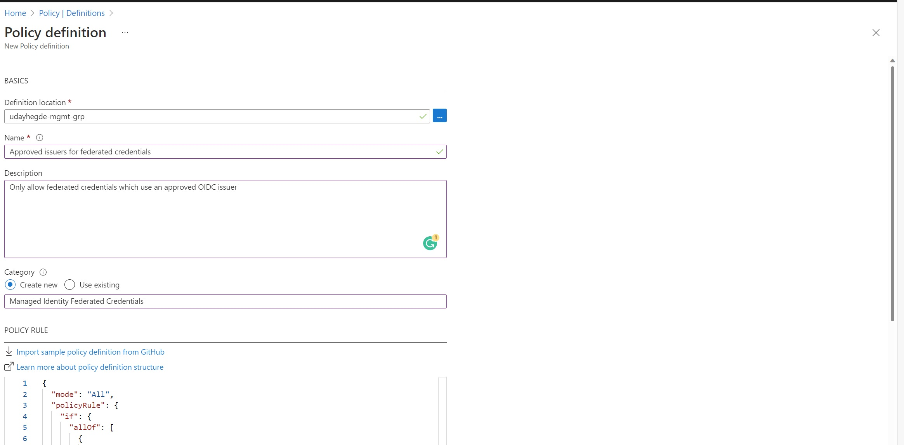
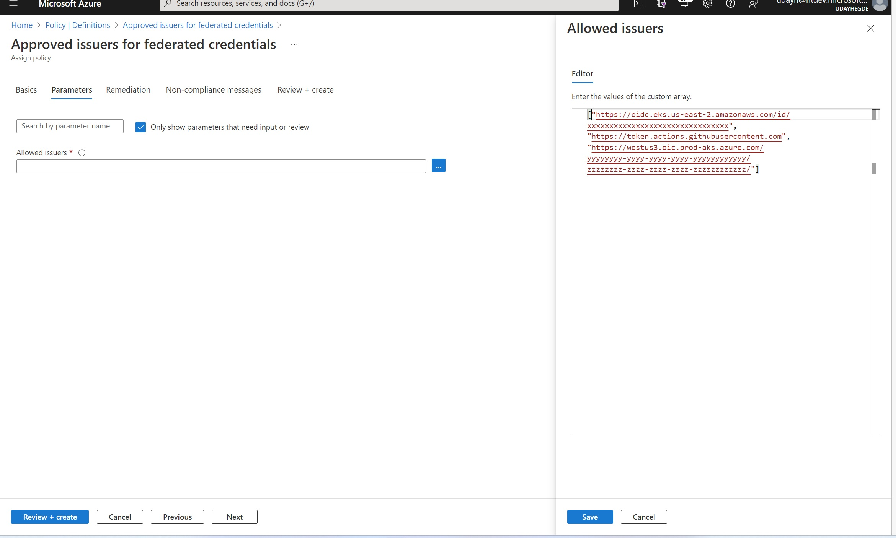
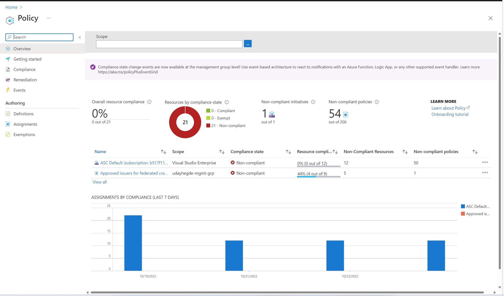
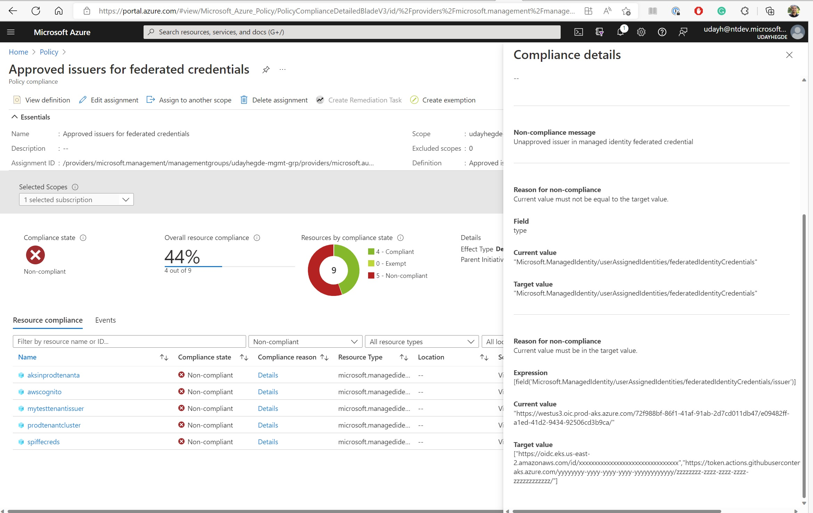
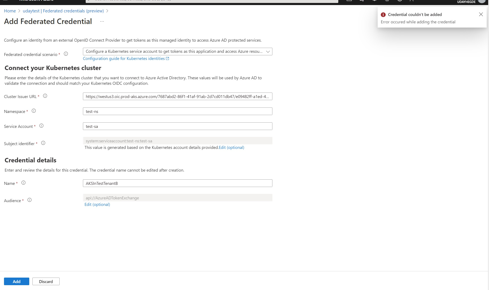

Recently, Microsoft added the workload identity federation capability to Azure managed identities. For details on this capability, see this [blog post from earlier this month](). Since managed identities are Azure resources, we can also use the Azure policy to control the configuration of workload identity federation. When developers configure their managed identities with workload identity federation, they specify an OIDC token issuer. Managed identity access tokens can be requested using tokens from this trusted issuer. Azure policy allows us to restrict the OIDC token issuers used in this federation. We will consider two scenarios in this blog post. Restrict workload identity federation on managed identities to an approved list of issuers and restrict workload identity federation on managed identities to any Azure Kubernetes Service (AKS) cluster in one or more tenants.

# Quick primer: what is Azure policy
The Azure policy is a service in Azure that allows you to define policies on Azure resources. It helps enforce business rules as well as check compliance with these rules. You can assign your policy definitions to a scope, such as a management group, a subscription, a resource group, or individual resources. 

If you want to author policy definitions that apply to all azure resources in your tenant, you can assign those definitions to the root management group. This group includes all management groups and all subscriptions in the tenant.

To work with Azure policies, [visit the Azure portal](https://portal.azure.com), search for "policy", and pick the "Policy" service. You will see an overview of Azure policy. You can define new policy definitions in the policy service and assign those definitions to Azure resources.

Azure policy definitions use a JSON format to specify the rules that need to be evaluated by the policy. The policy definitions can get complicated and hard to debug, so be patient and experiment as you build your expertise in this area. There is also a Visual Studio Code extension for Azure policy, which simplifies this experience.

When creating new resources, these Azure policies are evaluated and enforced. Any existing resources that don't adhere to the rules defined in the policy will show up in a compliance report.

## Defining a policy to restrict federation with an approved set of issuers.
Let's see how we can define an Azure policy to allow only a known set of OIDC issuers.

In this example, let's assume you want to only allow three OIDC issuers for federation with managed identities in your tenant (or a specific management group or subscription).
- An EKS cluster in AWS  (https://oidc.eks.us-east-2.amazonaws.com/id/xxxxxxxxxxxxxxxxxxxxxxxxxxxxxxxx)
- GitHub actions (https://token.actions.githubusercontent.com)
- An AKS cluster in Azure (https://westus3.oic.prod-aks.azure.com/yyyyyyyy-yyyy-yyyy-yyyy-yyyyyyyyyyyy/zzzzzzzz-zzzz-zzzz-zzzz-zzzzzzzzzzzz/)

Go to the authoring section of Azure policy in the portal, and pick "Policy definition".
For the location, pick the management group or subscription where you want to define this policy.
Use a name that makes sense for you. For example: "Approved issuers for federated credentials".
Description: "Only allow federated credentials which use an approved OIDC issuer".
Category: either pick a category that already exists or create a new category (for example, Managed Identity Federated Credentials)



The policy rule will be as follows:
```
{
  "mode": "All",
  "policyRule": {
    "if": {
      "allOf": [
        {
          "field": "type",
          "equals": "Microsoft.ManagedIdentity/userAssignedIdentities/federatedIdentityCredentials"
        },
        {
          "not": {
            "value": "[field('Microsoft.ManagedIdentity/userAssignedIdentities/federatedIdentityCredentials/issuer')]",
            "in": "[parameters('allowedIssuers')]"
          }
        }
      ]
    },
    "then": {
      "effect": "deny"
    }
  },
  "parameters": {
    "allowedIssuers": {
      "type": "Array",
      "metadata": {
        "displayName": "Allowed issuers",
        "description": "The list of allowed issuers for federated credentials."
      }
    }
  }
}
```
This policy definition says:
- when creating a resource of type federatedIdentityCredentials
- if the issuer is not in the allowedIssuers list
- deny the creation

We will be able to provide the list of approved issuers when we assign this policy.

Click on Assign policy and provide the scope and parameters for this policy.



Once the policy is assigned, Azure policy will check this policy against all existing resources of this type. In a few minutes, you will see a compliance report. In my case, it shows that there are several resources already out of compliance


Picking one of them why the resource is out of compliance


Now, when creating a federated identity credential on a managed identity that is in scope for this policy, the creation is allowed only if the issuer is in the allowedIssuers list. Otherwise, it will fail with an error. Unfortunately, the error message is very obscure and does not tell you anything specific to figure out what happened.




## Defining a policy to allow multiple AKS clusters in a tenant
While the allowedIssuers policy that we just defined should meet most of your needs, in some cases, you may need to configure this list with tens or hundreds of Kubernetes clusters. We can use the format of the issuer URL used by Azure Kubernetes Service to allow any AKS cluster in one or more tenants.

The format of the AKS issuer URL is as follows: https://<region>.oic.prod-aks.azure.com/<tenant-id>/<unique-id-for-cluster-url>/
Knowing this format, we can author a policy definition that allows either an approved issuer list or AKS clusters in a set of tenants.
```
{
  "mode": "All",
  "policyRule": {
    "if": {
      "allOf": [
        {
          "field": "type",
          "equals": "Microsoft.ManagedIdentity/userAssignedIdentities/federatedIdentityCredentials"
        },
        {
          "not": {
            "anyOf": [
              {
                "value": "[field('Microsoft.ManagedIdentity/userAssignedIdentities/federatedIdentityCredentials/issuer')]",
                "in": "[parameters('allowedIssuers')]"
              },
              {
                "allOf": [
                  {
                    "value": "[if(greaterOrEquals(length(split(field('Microsoft.ManagedIdentity/userAssignedIdentities/federatedIdentityCredentials/issuer'),'/')),3),split(field('Microsoft.ManagedIdentity/userAssignedIdentities/federatedIdentityCredentials/issuer'),'/')[2],'')]",
                    "like": "*.oic.prod-aks.azure.com"
                  },
                  {
                    "value": "[if(greaterOrEquals(length(split(field('Microsoft.ManagedIdentity/userAssignedIdentities/federatedIdentityCredentials/issuer'),'/')),4),split(field('Microsoft.ManagedIdentity/userAssignedIdentities/federatedIdentityCredentials/issuer'),'/')[3],'')]",
                    "in": "[parameters('allowedTenants')]"
                  }
                ]
              }
            ]
          }
        }
      ]
    },
    "then": {
      "effect": "deny"
    }
  },
  "parameters": {
    "allowedIssuers": {
      "type": "Array",
      "metadata": {
        "displayName": "Allowed issuers",
        "description": "The list of allowed issuers for federated credentials."
      }
    },
    "allowedTenants": {
      "type": "Array",
      "metadata": {
        "displayName": "Allowed tenants",
        "description": "Azure Kubernetes cluster issuers from these tenants are allowed".
      }
    }
  }
}

```
This policy definition says:
- when creating a resource of type federatedIdentityCredentials
- deny the creation unless the issuer is in the allowedIssuers list or the issuer is an AKS cluster in the allowedTenants list

I find the regular expression in Azure policy quite complicated. The greaterOfEquals may not be necessary in this particular policy definition. It's there for completeness if you want to use a similar policy in other scenarios.


## In conclusion
You can use Azure policy to control which issuers are allowed on federated credentials for user-assigned managed identities. Getting the regular expressions in Azure policy can be a struggle, but it can achieve powerful outcomes! There are additional capabilities we have not discussed: for example, you can author exemptions to exclude certain resources from specific policies. You can also author different policy definitions that should apply to selected resources, for example fewer approved issuers for Azure resources in your production subscription.. 

If you have any comments, feedback, or suggestions on this topic, I would love to hear from you. [DM me on Twitter](https://twitter.com/messages/compose?recipient_id=1446741344)
