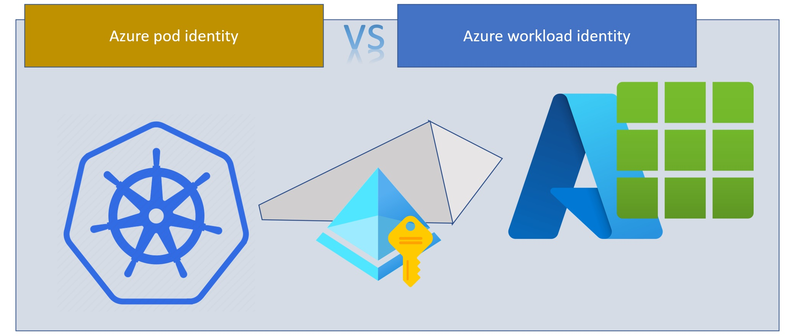
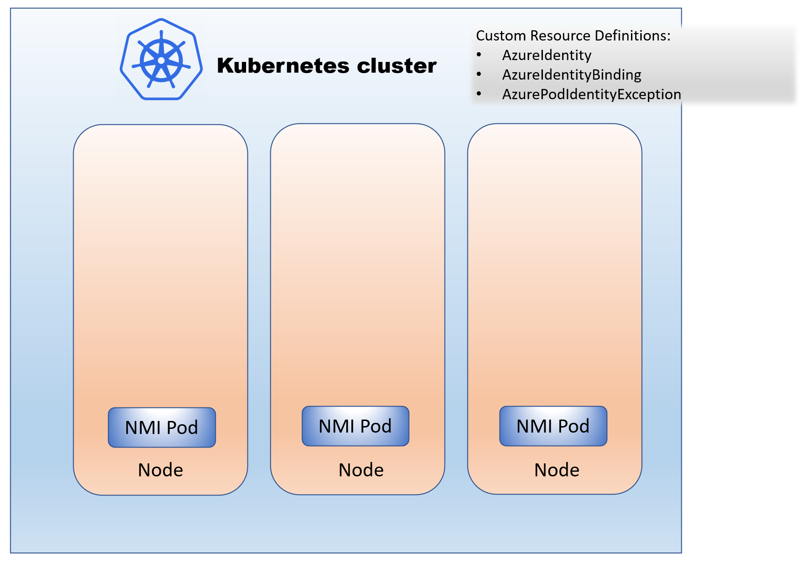
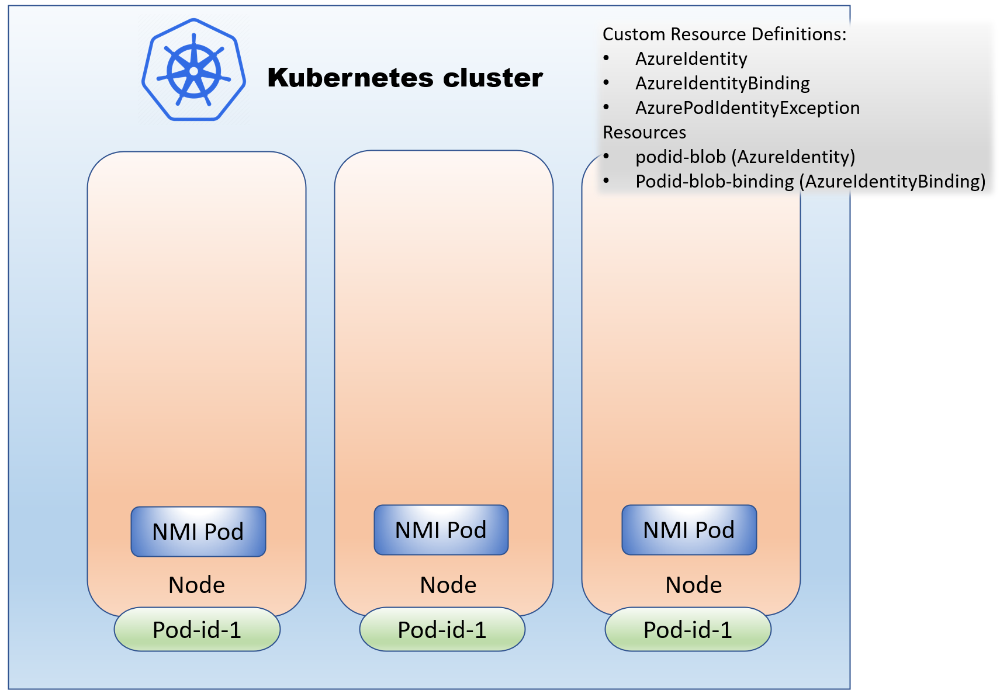
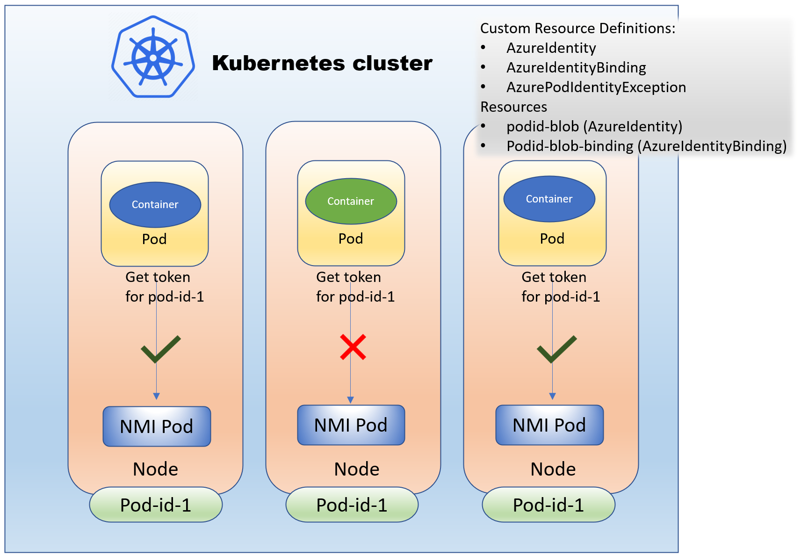
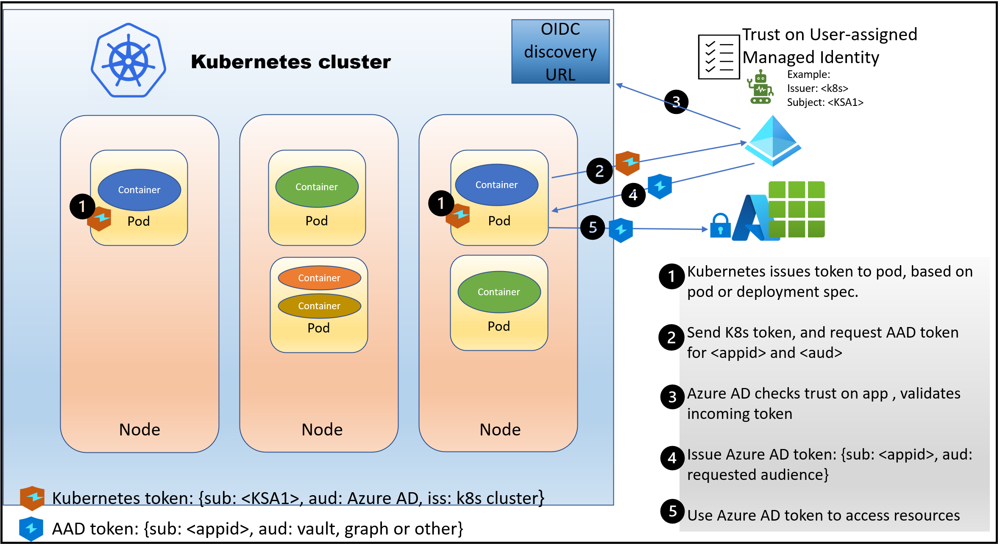

Managed identities in Azure allow software workloads to access Azure resources without needing secrets. However, these identities can only be used in workloads on Azure compute like VMs, App Services, and Functions. Azure AD pod-managed identity is a public preview feature in Azure Kubernetes Service (AKS) that enables workloads in Kubernetes clusters to use managed identities. This feature is now deprecated. Azure workload identity for Kubernetes replaces pod-managed identity. Azure workload identity also addresses several limitations that exist in pod-managed identity. This blog post walks through a comparison between pod identity and workload identity.



## What is Azure AD pod-managed identity in AKS?
Pod-managed identity uses the [open-source pod identity project](https://github.com/Azure/aad-pod-identity) that supports using managed identities in Kubernetes clusters. [See the AKS documentation](https://learn.microsoft.com/en-us/azure/aks/use-azure-ad-pod-identity) on how to register the feature and enable it.

The design of pod-managed identity requires the managed identities to be available on all the nodes in the Kubernetes clusters. Pod-managed identity intercepts all token requests to ensure that pods can get tokens only for the managed identities authorized for their use.  Three Custom Resource Definitions (CRDs) are added to the cluster when this feature is enabled. 
- AzureIdentity CRD allows you to represent your managed identity in a namespace in your Kubernetes clusters. 
- AzureIdentityBinding CRD binds an AzureIdentity to a selector in the namespace.  Any pod or deployment spec using this selector can request tokens for the managed identities associated with the binding.
- AzurePodIdentityException CRD enables you to allow selective pods to get tokens for any managed identity assigned to the cluster nodes! 

When you enable pod-identity in an AKS cluster, a DaemonSet of NMI (Node Managed Identity) pods is deployed in the kube-system namespace. These pods intercept all token requests to the managed identity token endpoint, also known as the Instant Metadata Service (IMDS) endpoint.
NMI executes the following checks before forwarding the request to the IMDS endpoint. 
- Check if the pod has an AzurePodIdentityException. If it has one, pass the token request to IMDS without additional checks.
- Otherwise, verify that the pod has an AzureIdentityBinding. If there is no binding, reject the token request.
- If the token request includes a client_id, the NMI verifies that it matches one of the identities associated with the binding used by the pod. The token request is sent to the IMDS endpoint if there is a match.  Else, the token request fails.  
- If the token request does not include a client_id, the NMI decides which identity to use.  It picks one of the matching identities associated with the binding for the token request.

Now let's walk through how this works step-by-step.

### Step 1: When pod identity is enabled in the cluster

Enabling pod identity in the cluster results in three CRDS to be configured in the cluster and the NMI pods to be deployed on every cluster node. To enable pod identity, a cluster admin has to run “az aks update –enable-pod-identity.” 



### Step 2: Developers assign an identity to a pod.  
For the developers to assign an identity to a pod, they need an AzureIdentityBinding selector. So the cluster admin first needs to add the AzureIdentity and AzureIdentityBinding resources.  Adding the AzureIdentity resource causes the matching managed identity to be assigned to the cluster nodes. This assignment requires the cluster identity to be in the Managed Identity Operator role on the managed identity. So usually, this step involves the following:
- The developer asks the managed identity owner to assign the Managed Identity Operator role to the cluster identity. 
- The developer asks the cluster admin to add the AzureIdentity and related binding to the cluster.

Here's an example showing the result of adding the AzureIdentity and binding in the cluster

```
az aks pod-identity add -g podworkloadcompare --cluster-name k8spodid --namespace app \
  --name podid-blob --identity-resource-id /subscriptions/22a08bf1-fb31-4757-a836-cd035976a2c0/resourcegroups/PodWorkloadCompare/providers/  Microsoft.ManagedIdentity/userAssignedIdentities/pod-id-1
```
This will result in an AzureIdentity resource called podid-blob and a AzureIdentityBinding resource with a podid-blob selector.



-  The developer then deploys a pod in the namespace using the binding in the deployment spec.

<pre>
apiVersion: apps/v1
kind: Deployment
metadata:
  name: blobapp-deployment
  namespace: oldapp 
  labels:
    app: blobapp
spec:
  replicas: 2
  selector:
    matchLabels:
      app: blobapp
  template:
  #this is the pod spec
    metadata:
      labels:
        app: blobapp
        <b>aadpodidbinding: podid-blob</b>
    spec:
      containers:
</pre>

Here's a view of showing the NMI allowing or disallowing token requests based on the binding used by the pods. 



Since each deployment is limited to using a single aadpodidbinding, pods needing to use more than one managed identity need a selector that matches all those identities.
For example:
```
az aks pod-identity add -g podworkloadcompare --cluster-name k8spodid \
   --namespace oldapp --name podid-table \
   --identity-resource-id /subscriptions/<id>/resourcegroups/<rg>/providers/Microsoft.ManagedIdentity/userAssignedIdentities/pod-id-2 \
   --binding-selector multi-id-binding

az aks pod-identity add -g podworkloadcompare --cluster-name k8spodid \
   --namespace oldapp --name podid-kv \
  --identity-resource-id /subscriptions/<id>/resourcegroups/<rg>/providers/Microsoft.ManagedIdentity/userAssignedIdentities/pod-id-3 \
  --binding-selector multi-id-binding
```

This multi-id-binding allows the pod to request tokens for either of the two identities matching that selector.
To request a token, use DefaultAzureCredential({managedIdentityClientId : client_id}) from the Azure Identity SDK. By specifying the client_id, you can avoid potential bugs by ensuring you get the correct token. 
While pod-managed identity in AKS provides powerful capabilities to assign identities to workloads, it has several limitations.

- It requires all the identities needed by every pod in the cluster to be assigned to every cluster node. This assignment affects scale and performance, especially in a large cluster, as more nodes are added.
- Since the identities need to be assigned to every cluster node, the cluster identity needs the Managed Identity Operator role on each of the managed identities. This weakens the security posture.
- Developers cannot provide their software workloads with the identities needed without help from cluster admins. The cluster admins have to add the AzureIdentity and AzureIdentityBinding resources.
- Anyone with privileges in the cluster can provide exceptions to software workloads. This exception allows those workloads to get tokens for any managed identity configured in the cluster, which weakens the security posture.
- The pod-managed identity approach is only available for clusters in Azure.
- It is only available on Linux nodepools, and not available on Windows.


## How is Azure workload identity for Kubernetes different?
Kubernetes added Service Account Token Volume Projection (stable in v1.20), which allows Kubernetes to issue tokens to service accounts at a file path. Using these tokens, you can federate with an external identity provider such as Azure Active Directory to access cloud resources. 



My earlier blog posts on [Application identities]() and [Managed identities]() provide details on how this pattern works. Azure workload identity for Kubernetes uses workload identity federation to overcome the limitations of pod-managed identity.
- Since cluster nodes don't need to be assigned identities, it avoids scale and performance issues. Not having the identities on cluster nodes also improves the overall security posture.
- Developers can use native Kubernetes constructs and not depend on the cluster admin to provision identities for their software workloads.
- It works consistently in any Kubernetes cluster: in Azure, in AWS, in GCP, or on-premises. This consistency is essential as multi-cloud is becoming the norm in several customer environments. It also works in any nodepools, Linux or Windows.
- It works consistently for Azure AD application identities and managed identities, without needing any secrets.


Things to be aware of when you use workload identity:
- There is a limit of 20 federated credentials on an Azure AD managed identity or application identity. Additional Azure AD identities can help when you run into this limit.
- From the security perspective, you are making the Kubernetes cluster a token issuer and using the tokens to access Azure resources. Any compromise of the token signing keys will allow attackers to access all resources available to any pod in the cluster. So the token signing keys need to be stored securely and rotated regularly. Azure Kubernetes Service rotates these keys every six months. When using a self-managed cluster, you should plan for key hygiene and rotate these keys regularly. The API server stores the keys in the etcd store. So it is critical to ensure the security of the etcd store.

Azure workload identity design ensures that developers can continue using DefaultAzureCredential in their code. This design uses an open-source admission webhook that can be added to any Kubernetes cluster. AKS adds this webhook when you enable workload identity. The webhook uses annotations on service accounts to simplify the configuration for acquiring tokens. The DefaultAzureCredential in the Azure Identity SDK detects these environment variables to facilitate the token acquisition from Azure AD. 

Upgrading from pod-managed identity to workload identity is simple since these features can run side-by-side. [Read this blog post]() for a step-by-step walkthrough of this upgrade.


## In conclusion
Pod-managed identity enables the use of managed identities in Kubernetes clusters. However, it has several limitations that impact scale, performance, and developer experience. It also weakens the security posture with identities assigned to every cluster node. Azure workload identity leverages recent updates to Kubernetes to address these limitations. Plan to upgrade your workloads from pod-managed identity to workload identity. 

If you have any comments, feedback, or suggestions on this topic, I would love to hear from you. [DM me on Twitter](https://twitter.com/messages/compose?recipient_id=1446741344)
