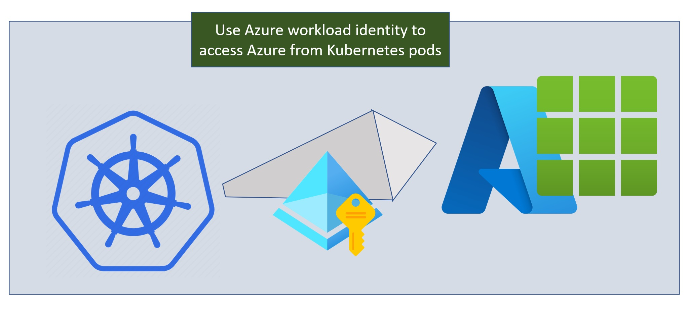

Pod identity is an open-source project that enables using Azure managed identities in Kubernetes clusters. Pod-managed identity, a public preview feature in Azure Kubernetes Service (AKS), is built upon the pod identity project. Pod identity is now deprecated and not recommended for use in your Kubernetes clusters. Azure workload identity, which is simpler to use and overcomes several limitations, replaces pod identity. Azure workload identity can be used side-by-side with pod identity, making it easy to upgrade your deployments. This blog article walks you through how you can seamlessly and gradually move each of your Kubernetes deployments from pod identity to workload identity.



For details on pod-managed identity in AKS, including a comparison with workload identity, [see this blog post.]()

## Upgrading your deployments
We will start with the most common usage pattern, where your pod is using a single managed identity. 


### Step 1: Upgrade your AKS cluster
To use workload identity in your AKS cluster, you need the following:
- azure cli version 2.40.0 or higher (use "az version" to check, use "az upgrade" to move to a newer version)
- aks-preview extension at 0.5.102 or higher (use "az version" to check, to add or update use "az extension add/update --name aks-preview")
- AKS cluster at 1.21 or higher. (use "az aks show -g <resource-group> -n <cluster-name>" to check the cluster version. Use "az aks upgrade --kubernetes-version <version-number>" to upgrade to version 1.21 or higher)

Here's a reference to the [AKS documentation on workload identity.](https://learn.microsoft.com/en-us/azure/aks/workload-identity-overview)

### Step 2: Enable workload identity in your cluster
This step will enable the Kubernetes feature to issue tokens to Kubernetes service accounts. 

```
az aks update -n <ClusterName> -g myResourceGroup --enable-oidc-issuer --enable-workload-identity
```

When you run this command, AKS configures the cluster with two capabilities:
1. AKS configures the Kubernetes cluster as a token issuer, issuing tokens to Kubernetes service accounts. The signing keys used for these tokens are published at an OIDC discovery endpoint (also called the "issuer URL"). When the AKS update completes, it provides the OIDC issuer URL for the cluster.
```
 "oidcIssuerProfile": {
    "enabled": true,
    "issuerUrl": "https://westus3.oic.prod-aks.azure.com/72f988bf-86f1-41af-91ab-2d7cd011db47/5e06c72d-8aa1-4e5e-83bf-86b0393dfd74/"
  },
```
2. AKS adds an admission webhook in the kube-system namespace. "kubectl get pods -n kube-system" shows the webhook pods. Here's an example from my cluster:
```
azure-wi-webhook-controller-manager-68f887c985-4xd96   1/1     Running   0          21h
azure-wi-webhook-controller-manager-68f887c985-z8mlw   1/1     Running   0          21h
```
This webhook simplifies the configuration for using the Kubernetes token. 

### Step 3: Create a Kubernetes service account to match your pod identity binding
First, pick a deployment you want to upgrade to Azure workload identity. Your deployment spec uses an AzureIdentityBinding selector to get tokens for a managed identity. This selector maps to an AzureIdentityBinding. The AzureIdentity resource associated with this binding identifies the client_id of your managed identity. 

Create a service account yaml file and annotate it with details of the managed identity. Here's an example of my service account yaml file. The admission webhook uses the annotations and labels to set up the configuration for Kubernetes to issue tokens and for the Azure Identity SDK to get Azure AD tokens.
```
apiVersion: v1
kind: ServiceAccount
metadata:
  name: blob-sa
  namespace: app
  #
  # Annotate the service account with the managed identity which
  # has access to our Blob store.
  #
  annotations:
    azure.workload.identity/client-id: bda293a8-529b-4007-ba2f-59ab5c5dc00a
    azure.workload.identity/tenant-id: 72f988bf-86f1-41af-91ab-2d7cd011db47
  labels:
    azure.workload.identity/use: "true"
```

You can find the client-id in the AzureIdentity resource matching the AzureIdentityBinding selector in your deployment spec. Alternatively, you can use the following steps:
- Get the AzureIdentityBinding selector for the deployment you want to upgrade. Here's an example of the blobapp-deployment in my app namespace
```
kubectl.exe get deployment blobapp-deployment -n app -o json | \
   jq -r '.spec.template.metadata.labels.aadpodidbinding'
```
This shows that my deployment is using the "podid-blob" selector.

- Next, find the AzureIdentity resource matching this selector.
```
kubectl.exe get AzureIdentityBinding -n app -o json |  \
  jq -r '.items[] | select (.spec.selector | test("podid-blob")).spec.azureIdentity'
```
This shows that the AzureIdentity matching my selector is "podid-blob".

- Find the client_id of the managed identity associated with this AzureIdentity
```
kubectl.exe get AzureIdentity podid-blob -n app -o json | jq -r '.spec.clientID'
```
This tells us that the client_id of my managed identity is bda293a8-529b-4007-ba2f-59ab5c5dc00a

You also need the tenant-id. Assuming that you have set an active subscription with az cli, one way to get the tenant-id is:
```
az account show | jq -r '(.tenantId)'
```

Use kubectl apply -f serviceaccount.yaml to create the service account.

#### Understanding the service account annotations
The admission webhook uses the annotations of client-id and tenant-id in the service account. The webhook injects additional config if the azure.workload.identity/use label is true on the service account. Here's a sample configuration that's automatically generated by the mutating webhook, based on the annotations on the service account.

```
        env: 
        - name: AZURE_CLIENT_ID
          value: bda293a8-529b-4007-ba2f-59ab5c5dc00a
        - name: AZURE_TENANT_ID
          value: 72f988bf-86f1-41af-91ab-2d7cd011db55
        - name: AZURE_FEDERATED_TOKEN_FILE
          value: /var/run/secrets/tokens/azure-identity-token
        volumeMounts: 
        - mountPath: /var/run/secrets/tokens
            name: azure-identity-token
            readonly: true
      volumes:
      - name: azure-identity-token
        projected:
          defaultMode: 420
          sources:
          - serviceAccountToken:
              audience: api://AzureADTokenExchange
              expirationSeconds: 3600
              path: azure-identity-token
```


### Step 4: Setup your managed identity to trust your Kubernetes service account
The owner of the managed identity has to create a federated credential, providing details of the cluster issuer and service account.
```
az identity federated-credential create --name <name for this credential> \
  --identity-name <userAssignedIdentityName> --resource-group <resourceGroupName> \
  --issuer <AKS issuer URL> --subject system:serviceaccount:<namespace>:<serviceAccountName>
```
In my case, this command looks like this:
```
az identity federated-credential create -g podworkloadcompare 
  --name "credentialForMyBlobApp" --identity-name pod-id-1 \
  --issuer https://westus3.oic.prod-aks.azure.com/72f988bf-86f1-41af-91ab-2d7cd011db47/5e06c72d-8aa1-4e5e-83bf-86b0393dfd74/ \
  --subject system:serviceaccount:app:blob-sa
```

On success, this returns: 

```
{
  "audiences": [
    "api://AzureADTokenExchange"
  ],
  "id": "/subscriptions/22a08bf1-fb31-4757-a836-cd035976a2c0/resourcegroups/podworkloadcompare/providers/Microsoft.ManagedIdentity/userAssignedIdentities/pod-id-1/federatedIdentityCredentials/credentialForMyBlobApp",
  "issuer": "https://westus3.oic.prod-aks.azure.com/72f988bf-86f1-41af-91ab-2d7cd011db47/5e06c72d-8aa1-4e5e-83bf-86b0393dfd74/",
  "name": "credentialForMyBlobApp",
  "resourceGroup": "podworkloadcompare",
  "subject": "system:serviceaccount:app:blob-sa",
  "type": "Microsoft.ManagedIdentity/userAssignedIdentities/federatedIdentityCredentials"
}
```

### Step 5: Update your deployment with the service account
Configure your deployment to use the service account and the sidecar that acquires Azure AD token without needing any code changes.

The following is my new deployment yaml with these changes added. Note that I haven't removed my AzureIdentityBinding yet. I will remove that once I have verified the deployment has switched over to Azure workload identity. Note the bolded lines showing the updates to the deployment spec.

<pre>
apiVersion: apps/v1
kind: Deployment
metadata:
  name: blobapp-deployment
  namespace: app 
  labels:
    app: blobapp
spec:
  replicas: 3
  selector:
    matchLabels:
      app: blobapp
  template:
  #this is the pod spec
    metadata:
      <b>annotations:
        azure.workload.identity/inject-proxy-sidecar: "true"</b>
      labels:
        app: blobapp
        aadpodidbinding: podid-blob-binding
    spec:
      <b>serviceAccountName: blob-sa</b>
      containers:
      - name: blobapp-container
        image: acruday.azurecr.io/blobapp:oldv2
        ports:
        - containerPort: 3001
        env: 
        - name: BLOB_STORE_ACCOUNT
          value: podblob
</pre>

 The admission webhook will detect the annotations in the deployment spec. If it sees the annotation of azure.workload.identity/inject-proxy-sidecar is true, it injects a sidecar "azwi-proxy" in the pods as they are deployed. The sidecar's job is to intercept calls to the IMDS and exchange the Kubernetes service account token for an Azure AD token. 

Apply the deployment spec using kubectl apply -f. Your deployment should now have switched over to Azure workload identity. 

To confirm, perform any action that will cause your workload to get an Azure AD token for the managed identity.
Then check the logs of the sidecar proxy:

```
kubectl logs  blobapp-deployment-5c56555d67-kwrkk -n app -c azwi-proxy
I1027 00:39:44.494138       1 proxy.go:96] proxy "msg"="starting the proxy server"  "port"=8000 "userAgent"="azure-workload-identity/proxy/v0.13.0 (linux/amd64) 46c5137/2022-08-31-23:38"
I1027 00:39:44.565901       1 proxy.go:167] proxy "msg"="received readyz request"  "method"="GET" "uri"="/readyz"
I1027 03:59:24.506573       1 proxy.go:101] proxy "msg"="received token request"  "method"="GET" "uri"="/metadata/identity/oauth2/token"
I1027 03:59:24.510993       1 proxy.go:101] proxy "msg"="received token request"  "method"="GET" "uri"="/metadata/identity/oauth2/token?resource=https%3A%2F%2Fstorage.azure.com&api-version=2018-02-01&client_id=bda293a8-529b-4007-ba2f-59ab5c5dc00a"
I1027 03:59:24.956687       1 proxy.go:123] proxy "msg"="successfully acquired token"  "method"="GET" "uri"="/metadata/identity/oauth2/token?resource=https%3A%2F%2Fstorage.azure.com&api-version=2018-02-01&client_id=bda293a8-529b-4007-ba2f-59ab5c5dc00a"
```

#### Understanding the sidecar annotation
The Azure Identity SDK is updated to use the environment variables set up by the mutating webhook. The DefaultAzureCredential() will use these variables, removing the need to change your code. However, you do have to pick up the latest version of the SDK. The following are the minimum versions of the SDK with this behavior:
-	.NET: 1.5.0
-	Java: 1.4.0
-	JavaScript: 2.0.0
-	Python: 1.7.0
-	Go: not supported yet 

The sidecar should only be used as a stopgap while you plan to update the Azure Identity SDK in your deployment.

This sidecar is optional and only needed if you are using an older version of the Azure Identity SDK. You can also choose to update the Azure Identity SDK in your deployment instead of using the sidecar.

### Step 6: Remove the pod identity binding
At this point, we can safely remove the aadpodidbinding from the deployment yaml, and redeploy.

### Step 7: clean up pod identity
If the aadpodidbinding selector is not used by any other deployment, the cluster admin can delete the AzureIdentity and AzureIdentityBinding resources.

```
az aks pod-identity delete -g <resource-group> -n <pod-identity-name> \
   --cluster-name <cluster name> --namespace <namespace>
```
This deletes the AzureIdentity and its binding. If this is the last reference to the managed identity in the cluster, the managed identity is removed from the cluster nodes. 

Once all the pod identities are deleted across all namespaces, the cluster admin can remove the pod-managed identity features from the cluster.

```
az aks update -g <resource-group> -n cluster-name --disable-pod-identity
```
This removes all the custom resource definitions from the cluster.

The cluster identity will still have the role of Managed Identity Operator on the managed identities. You can remove that role from each of the managed identities.

## Advanced topics

### Dealing with AzureIdentityBinding selectors that reference multiple managed identities
In most cases, the AzureIdentityBinding selector matches a single managed identity. However, there may be cases where you set multiple AzureIdentityBindings to a single selector, allowing your pod to get tokens for multiple managed identities. 

For example:
```
kubectl.exe get AzureIdentityBinding -n app -o json |  \
   jq -r '.items[] | select (.spec.selector | test("pod-kvtable-binding")).spec.azureIdentity' 
```

tells me that two AzureIdentities are matching this selector: podid-kv and podid-table. The client_id's matching these are f7b76e44-617f-490a-ab20-d963fcf7d54f and 7ed66f16-433f-4ef5-8b10-a72cdfecd217 respectively. Since I am dealing with two managed identities here, my code has to configure DefaultAzureCredential with the client_id of the managed identity we want to use.

In these cases, skip the client-id annotation on the service account. 
```
kind: ServiceAccount
metadata:
  name: kvtable-sa
  namespace: app
  #
  # Annotate the service account with the managed idenity which
  # has access to our Blob store.
  #apiVersion: v1

  annotations:
    # no client-id annotation, since we are dealing with multiple identities
    azure.workload.identity/tenant-id: 72f988bf-86f1-41af-91ab-2d7cd011db47
  labels:
    azure.workload.identity/use: "true"
```

Since you will be calling DefaultAzureCredential({ManagedIdentityClientId = client_id}), the Azure Identity SDK will not need the AZURE_CLIENT_ID environment variabile. It will use the remaining parameters set up by the mutating webhook to exchange the Kubernetes token for an Azure AD token.

### Special care for init containers
In some cases, your deployment may be using an init container. This is typically when you need some action to happen before your pod starts executing. For example, you may need to get a secret from a vault and keep it ready for your pod to use. 

Since the init container runs before the sidecar is injected, token requests from the init container will not be able to use the sidecar model. It is necessary for the code running in the init container to exchange the Kubernetes token for an Azure AD token. The container has to either use the latest Azure Identity SDK or use the ClientAssertionCredential in the Microsoft Authentication Library (MSAL). See [here](#ExchangeToken) for some examples.

### Self-managed clusters
This blog post focused on Azure Kubernetes Service. If you are using a self-managed cluster, most of the instructions in this blog post for upgrading your deployments will be the same. Use the [workload identity open source project](https://github.com/Azure/azure-workload-identity) to set up your cluster with workload identity. There is [detailed documentation](https://azure.github.io/azure-workload-identity/docs/) to help you with this.

## In conclusion
Azure workload identity replaces pod identity that is deprecated. As you might have observed from this blog post, moving from Azure pod identity to Azure workload identity is seamless and straightforward. Since these features can run side-by-side, you can upgrade each deployment independently.

If you have any comments, feedback, or suggestions on this topic, I would love to hear from you. [DM me on Twitter](https://twitter.com/messages/compose?recipient_id=1446741344)
